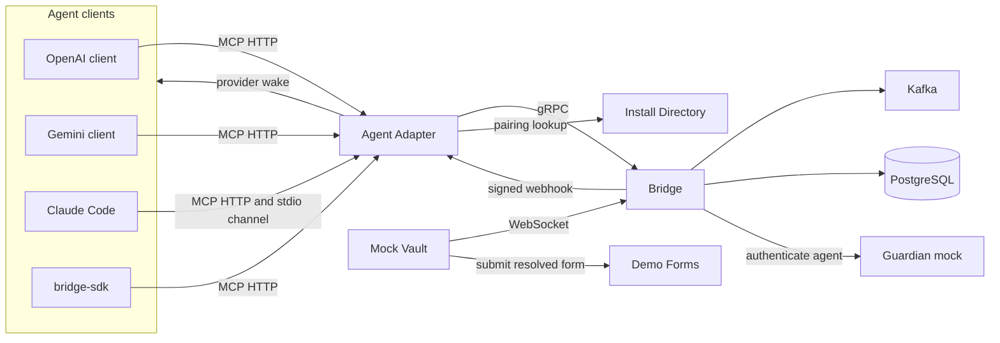
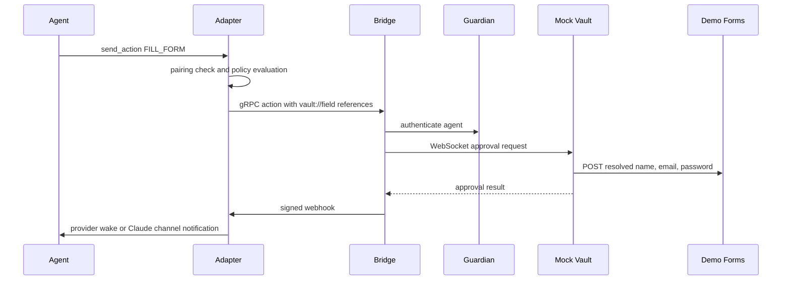

# THE BRIDGE

A Secure Mediation and Process Orchestration Layer for AI Agents

AI agents can take real actions, but giving an agent direct access to sensitive user data creates privacy and security risks. THE BRIDGE is a mediation and process orchestration layer between AI agents and trusted user-side services. The agent talks to a local Agent Adapter. The Bridge runs the workflow. Sensitive values stay under the control of the user's Vault instead of being handed to the agent in plaintext.

This repository is an academic final project. Several components are local demonstration stand-ins, including Mock Vault, Guardian, Install Directory, and Demo Forms. They show the architecture. They are not a production deployment.

## Key features

| Area | What the current code does |
| --- | --- |
| Agent interface | MCP tools on the Agent Adapter: `send_action`, `get_action_status`, `store_pii`, `evaluate_user_policy` |
| Orchestration | Bridge workflow engine, gRPC API, Kafka, PostgreSQL |
| Privacy policy | User/Vault-owned policy with decisions `AGENT_ALLOWED`, `VAULT_ONLY`, `USER_APPROVAL`, and aggregate `PARTIAL` |
| Policy gate | `send_action` evaluates policy before the action is sent. Evaluation failure or an unknown decision stops the action |
| Vault references | `vault://field/<field-name>` for Vault-owned values, and legacy `vault://pii/...` for the Adapter's local encrypted store |
| Guardian | Mock trust check of the agent identity before Vault work |
| Continuation | Webhook back to the Adapter by default, optional polling, then a provider-specific wake |
| OpenAI | Local client plus `OpenAIProvider` continuation into a conversation |
| Gemini | Local client plus `GeminiProvider` continuation into an interaction |
| Claude Code | `bridge-adapter` MCP tools and `bridge-wake` MCP channel. Completion is delivered with `notifications/claude/channel` |
| Pairing | Links an agent session to a user install and a Vault WebSocket endpoint |
| Demo form | Local registration page used as the FILL_FORM target |

`SEARCH_PRODUCT` can appear in the demo policy file. It is not a `send_action` action type.

## Architecture



| Component | Role in this repository |
| --- | --- |
| Agent clients | OpenAI, Gemini, Claude Code, and `bridge-sdk`. They call Adapter MCP tools. They do not call the Bridge directly |
| Agent Adapter | MCP server, policy gate, pairing, workflow memory, and provider wake |
| Bridge | Authoritative workflow engine. Exposes gRPC to the Adapter, HTTP/WebSocket to the Vault, and consumes Kafka |
| Guardian mock | Demo agent-trust service. Not a production guardian |
| Mock Vault | Demo user side: privacy policy, Vault-owned field values, WebSocket client, and the privacy UI |
| Install Directory | Demo pairing service and SQLite directory |
| Demo Forms | Demo registration site. Not a real product backend |
| PostgreSQL and Kafka | Infrastructure started with Docker Compose |

The Bridge `CHANNEL` connector is a generic HTTP callback. Claude Code does not use it. Claude completion uses the webhook connector, then the Adapter forwards the wake through the registered channel URL.

The Bridge `THREAD` connector exists in the Kotlin enum. The Adapter runtime does not select it. Normal runs use `WEBHOOK` or, if configured, `POLLING`.

## Privacy and policy model

The privacy policy is owned on the user/Vault side. The demo policy lives in `mock-vault/user_policy.json` and is edited in the privacy UI. The Adapter does not decide the policy. It asks the Vault to evaluate it.

`send_action` calls policy evaluation with **field names**, not field values. For `FILL_FORM` the names include `name`, `email`, `password`, plus any extra parameter names. `PAYMENT` and `TRANSACTION` still require a successful evaluation. They do not send card numbers or account values to the policy service as part of that call.

| Decision | Meaning in the current gate |
| --- | --- |
| `AGENT_ALLOWED` | The agent may supply that field. The value is forwarded |
| `VAULT_ONLY` | The agent must not supply the value. The Adapter replaces it with `vault://field/<field-name>` |
| `USER_APPROVAL` | The action is allowed to continue into the Bridge, Guardian, and Vault flow. The Adapter does not add a second prompt |
| `PARTIAL` | Aggregate result when some fields are agent-allowed and others are Vault-only |

If evaluation throws, the response is malformed, or the decision is not one of those four values, `send_action` returns an error and does not create a workflow. `FILL_FORM` also fails closed when the Vault's field classification does not match the requested fields.

### Two reference forms

| Reference | Who stores the value | Who resolves it |
| --- | --- | --- |
| `vault://field/email` | Mock Vault, in `mock-vault/vault_field_values.json` | Mock Vault, when it handles the workflow |
| `vault://pii/...` | Adapter-local encrypted store created by the `store_pii` tool | Mock Vault asks the Adapter's loopback `POST /vault/resolve` endpoint |

The Bridge does not decrypt either reference. For `FILL_FORM`, the Bridge rejects plaintext `email` or `password` and accepts only `vault://pii/...` or `vault://field/...`.

`store_pii` remains available. It is a separate legacy/demo store on the Adapter, not the user-owned Vault policy store.

## FILL_FORM flow



A typical request is: "Fill the demo registration form. My name is Alice."

With the demo policy, `name` is `AGENT_ALLOWED` and `email` and `password` are `VAULT_ONLY`. The agent supplies the name. The Adapter does not ask the agent for the email or password. The Mock Vault fills those from its own field store, submits `POST /api/register` on Demo Forms, and approves the workflow. The Adapter then wakes the provider that started the action.

## Repository structure

| Path | Purpose |
| --- | --- |
| `src/` | Bridge: Kotlin, Spring Boot, gRPC, workflow engine, Vault WebSocket |
| `agent-adapter/` | Python Adapter, provider clients, and the Claude channel |
| `agent-adapter/app/` | Adapter MCP server, policy gate, continuation, pairing |
| `agent-adapter/openai-client/` | Interactive OpenAI client |
| `agent-adapter/gemini-client/` | Interactive Gemini client |
| `agent-adapter/claude-channel/` | `bridge-wake` MCP channel used by Claude Code |
| `agent-adapter/shared_client/` | Shared HTTP auth and SSE helpers |
| `agent-adapter/gemini-bridge-hooks/` | Optional Gemini CLI hook experiments |
| `bridge-sdk/` | Small Python SDK that calls the Adapter over MCP |
| `guardian-mock/` | Demo Guardian HTTP service |
| `mock-vault/` | Demo Vault, privacy UI, and policy tests |
| `install-directory/` | Demo pairing directory |
| `demo-forms/` | Demo registration form |
| `src/main/proto/` | gRPC contract shared by the Bridge and the Adapter |

Python gRPC stubs under `agent-adapter/app/bridge/` are generated from that proto file and are imported by the Adapter. `generate_proto.sh` and `generate_proto.ps1` regenerate them.

## Prerequisites

| Tool | Notes |
| --- | --- |
| Git | Clone and update the repository |
| Java 21 | The project is developed with Java 21. Spring Boot 3.2 requires Java 17 or newer. Use the Gradle wrapper. A global Gradle install is not required |
| Python 3.10 or newer | Adapter, clients, mocks, and SDK |
| Node.js 20 or newer and npm | Claude channel only |
| Docker and Docker Compose | PostgreSQL, Kafka, and Kafka UI |

Windows instructions below use PowerShell and Docker Desktop. WSL is optional. It is not required to run the Bridge, Adapter, or demo services.

## Setup - macOS / Linux

Commands use Bash or Zsh. Run them from the repository root unless a step says otherwise.

### 1. Clone and enter the repository

```bash
git clone <repository-url>
cd <repository-directory>
```

### 2. Create and activate the virtual environment

```bash
python3 -m venv agent-adapter/.venv
source agent-adapter/.venv/bin/activate
python -m pip install --upgrade pip
python -m pip install -r agent-adapter/requirements.txt
python -m pip install -r agent-adapter/openai-client/requirements.txt
python -m pip install -r agent-adapter/gemini-client/requirements.txt
python -m pip install -e bridge-sdk
```

### 3. Install Claude channel dependencies

```bash
npm install --prefix agent-adapter/claude-channel
```

### 4. Create the local environment file

```bash
cp .env.example agent-adapter/.env
```

Edit `agent-adapter/.env`. Set `POSTGRES_PASSWORD`, `WEBHOOK_SECRET`, and `ADAPTER_AUTH_TOKEN` to values you choose. Add `OPENAI_API_KEY` only if you will run the OpenAI client. Add `GEMINI_API_KEY` only if you will run the Gemini client. Claude Code does not need an Anthropic API key.

Do not commit `agent-adapter/.env`.

### 5. Generate Python gRPC stubs if they are missing

The repository already contains the generated stubs. Regenerate them after changing `src/main/proto/bridge.proto`:

```bash
./generate_proto.sh
```

## Setup - Windows

Use PowerShell. Run Docker Desktop before the infrastructure step later in this document.

### 1. Clone and enter the repository

```powershell
git clone <repository-url>
cd <repository-directory>
```

### 2. Create and activate the virtual environment

```powershell
py -m venv agent-adapter\.venv
.\agent-adapter\.venv\Scripts\Activate.ps1
python -m pip install --upgrade pip
python -m pip install -r agent-adapter\requirements.txt
python -m pip install -r agent-adapter\openai-client\requirements.txt
python -m pip install -r agent-adapter\gemini-client\requirements.txt
python -m pip install -e bridge-sdk
```

If activation is blocked, allow scripts for the current process only, then activate again:

```powershell
Set-ExecutionPolicy -Scope Process -ExecutionPolicy RemoteSigned
.\agent-adapter\.venv\Scripts\Activate.ps1
```

### 3. Install Claude channel dependencies

```powershell
npm install --prefix agent-adapter\claude-channel
```

### 4. Create the local environment file

```powershell
Copy-Item .env.example agent-adapter\.env
```

Edit `agent-adapter\.env` with the same placeholders described in the macOS / Linux setup. Do not commit that file.

### 5. Generate Python gRPC stubs if they are missing

```powershell
.\generate_proto.ps1
```

The PowerShell generator matches `generate_proto.sh`: it writes the stubs into `agent-adapter\app\bridge` and fixes the gRPC import. This script has not been executed on Windows as part of the current development environment.

## Starting the system

Start the services in this order. Each long-running process needs its own terminal. On Windows, open a new PowerShell window and activate the virtual environment again:

```powershell
cd <repository-directory>
.\agent-adapter\.venv\Scripts\Activate.ps1
```

On macOS or Linux:

```bash
cd <repository-directory>
source agent-adapter/.venv/bin/activate
```

### 1. Infrastructure

```bash
docker compose up -d
```

PowerShell:

```powershell
docker compose up -d
```

This starts PostgreSQL on port 5432, Kafka on port 9092, and Kafka UI on port 8080. Zookeeper is used only inside the Compose network.

`docker-compose.yml` reads PostgreSQL settings from `agent-adapter/.env`. Create that file before this step.

### 2. Bridge

The Bridge process reads `POSTGRES_DB`, `POSTGRES_USER`, `POSTGRES_PASSWORD`, and `WEBHOOK_SECRET` from its own environment. Gradle does not load `agent-adapter/.env` by itself. Load that file in the Bridge terminal, then start Gradle.

macOS / Linux:

```bash
set -a
source agent-adapter/.env
set +a
./gradlew bootRun
```

Windows:

```powershell
Get-Content agent-adapter\.env | ForEach-Object {
    if ($_ -match '^\s*#' -or $_ -notmatch '=') { return }
    $name, $value = $_.Split('=', 2)
    Set-Item -Path "env:$($name.Trim())" -Value $value.Trim().Trim('"').Trim("'")
}
.\gradlew.bat bootRun
```

Wait until the gRPC server is listening on port 50051. The Spring HTTP port, including the Vault WebSocket, is 8081. `WEBHOOK_SECRET` in this terminal must match the Adapter, or completion webhooks are rejected.

### 3. Guardian mock

macOS / Linux, from the repository root, with the virtual environment active:

```bash
python guardian-mock/guardian_mock.py
```

Windows:

```powershell
python guardian-mock\guardian_mock.py
```

The demo Guardian trusts the agent id `agent-123`.

### 4. Install Directory

macOS / Linux:

```bash
python install-directory/server.py
```

Windows:

```powershell
python install-directory\server.py
```

### 5. Agent Adapter

macOS / Linux:

```bash
./agent-adapter/run_adapter_http.sh
```

That script loads `agent-adapter/.env`, forces HTTP MCP mode, and starts the Adapter on port 8000.

Windows does not run that Bash script. The Adapter loads `agent-adapter\.env` itself. In a new PowerShell window, with the virtual environment active:

```powershell
$env:MCP_TRANSPORT = "http"
$env:ADAPTER_HOST = "127.0.0.1"
$env:ADAPTER_PORT = "8000"
$env:CONNECTOR_TYPE = "WEBHOOK"
$env:CONNECTOR_CONTEXT = "http://127.0.0.1:8000/webhook/bridge"
python agent-adapter\app\adapter.py
```

The MCP endpoint is `http://127.0.0.1:8000/mcp`. The Bridge webhook endpoint is `http://127.0.0.1:8000/webhook/bridge`.

### 6. Mock Vault

macOS / Linux, from the repository root:

```bash
python mock-vault/vault_sim.py
```

Windows:

```powershell
python mock-vault\vault_sim.py
```

This process connects to the Bridge WebSocket and also serves the privacy UI on port 8020.

### 7. Demo Forms

macOS / Linux:

```bash
python demo-forms/server.py
```

Windows:

```powershell
python demo-forms\server.py
```

Open `http://127.0.0.1:9000/register` to see the demo form. Submissions are stored in memory for the life of that process.

### 8. Choose a provider

Continue with [Using OpenAI](#using-openai), [Using Gemini](#using-gemini), or [Using Claude Code](#using-claude-code).

## Ports

| Service | Port | Where it is set |
| --- | --- | --- |
| PostgreSQL | 5432 | `docker-compose.yml` |
| Kafka | 9092 | `docker-compose.yml` |
| Kafka UI | 8080 | `docker-compose.yml` |
| Bridge HTTP and Vault WebSocket | 8081 | `src/main/resources/application.properties` (`PORT`, default 8081). WebSocket path `/vault-websocket` |
| Bridge gRPC | 50051 | `src/main/kotlin/bridge/GrpcServer.kt` |
| Guardian mock | 8001 | `guardian-mock/guardian_mock.py`. Override the Bridge client with `GUARDIAN_BASE_URL` |
| Install Directory | 8010 | `INSTALL_DIRECTORY_PORT`, default in `install-directory/server.py` |
| Agent Adapter | 8000 | `ADAPTER_PORT` |
| Demo Forms | 9000 | `DEMO_FORMS_PORT`, default in `demo-forms/server.py` |
| Mock Vault privacy UI | 8020 | `VAULT_PRIVACY_PORT`, default in `mock-vault/policy_http.py` |

Claude's `bridge-wake` ingress uses an ephemeral local port unless `CHANNEL_PORT` is set. The Adapter records that URL during continuation registration. Do not hard-code it.

## Pairing

Pairing binds an agent session to a user install and to the Vault WebSocket endpoint. The Adapter asks the Install Directory for that mapping before it sends a new action.

When no completed pairing exists, `send_action` returns a pairing code and a page URL instead of a workflow id. Open that URL in a browser. The Install Directory serves it at `http://127.0.0.1:8010/pair`. Complete the page so the directory stores the install id and the Vault endpoint. The Adapter stores its local pairing record under `agent-adapter/app/data/`, which is not committed. The directory database is `install-directory/data/directory.sqlite3`, which is also not committed.

The demo Guardian and `agent-adapter/app/vault_config.json` use the agent id `agent-123`. The privacy policy file has its own `userInstallId`. Those demo identifiers are not printed here. Change them together if you replace the samples.

Install Directory, the Adapter, and Mock Vault should be running before you complete pairing. The Vault endpoint stored by the directory defaults to `ws://127.0.0.1:8081/vault-websocket`.

## Using OpenAI

The OpenAI client is `agent-adapter/openai-client/client.py`. It creates or reuses a conversation id, connects to Adapter MCP, injects `platform=openai` and that conversation id, and listens for Adapter Server-Sent Events. When the Bridge finishes, `OpenAIProvider` continues the same conversation. The client renders the new items.

Required in the environment of this process: `OPENAI_API_KEY`. Optional: `OPENAI_MODEL` (default `gpt-5.6`) and `BRIDGE_MCP_URL` (default `http://127.0.0.1:8000/mcp`).

The client loads a `.env` file from the current directory. It does not automatically read `agent-adapter/.env`. Load that file yourself before starting the client.

macOS / Linux:

```bash
set -a
source agent-adapter/.env
set +a
python agent-adapter/openai-client/client.py
```

Windows, after the virtual environment is active, set the key without printing it:

```powershell
$env:OPENAI_API_KEY = "<your OpenAI API key>"
$env:BRIDGE_MCP_URL = "http://127.0.0.1:8000/mcp"
python agent-adapter\openai-client\client.py
```

Example prompt:

```text
Pay 100 ILS.
```

Live calls depend on the OpenAI API. An HTTP 429 or quota error comes from that API, not from the Bridge.

## Using Gemini

The Gemini client is `agent-adapter/gemini-client/client.py`. It uses the Interactions API, Adapter MCP, and SSE. `GeminiProvider` wakes a follow-up interaction when the workflow completes.

The API key is `GEMINI_API_KEY`. `GOOGLE_API_KEY` is accepted as an alias. Optional: `GEMINI_MODEL` (default `gemini-3.6-flash`) and `BRIDGE_MCP_URL`.

This client loads both the current directory `.env` and `agent-adapter/.env`.

macOS / Linux:

```bash
source agent-adapter/.venv/bin/activate
python agent-adapter/gemini-client/client.py
```

Windows:

```powershell
.\agent-adapter\.venv\Scripts\Activate.ps1
python agent-adapter\gemini-client\client.py
```

Example prompt:

```text
Fill the demo registration form. My name is Alice.
```

Live calls depend on the Gemini API and its quota. A quota failure is not a Bridge defect.

`agent-adapter/gemini-bridge-hooks/` contains optional Gemini CLI experiments. The supported interactive path is `gemini-client/client.py`.

## Using Claude Code

Claude Code uses two MCP servers:

| Server | Transport | Role |
| --- | --- | --- |
| `bridge-adapter` | HTTP `http://127.0.0.1:8000/mcp` | Tools such as `send_action`. Sends `Authorization: Bearer <ADAPTER_AUTH_TOKEN>` |
| `bridge-wake` | stdio, spawned by Claude Code | Local channel. Registers `POST /continuation/register`, receives `POST /wake`, and emits `notifications/claude/channel` |

The committed `.mcp.json` starts only `bridge-wake`:

```json
{
  "mcpServers": {
    "bridge-wake": {
      "command": "bash",
      "args": ["agent-adapter/claude-channel/launch.sh"],
      "env": {
        "ADAPTER_BASE_URL": "http://127.0.0.1:8000"
      }
    }
  }
}
```

`agent-adapter/claude-channel/launch.sh` reads `agent-adapter/.env` and then runs the channel with `tsx`. The token stays in `.env`. It is not written into `.mcp.json`.

Register `bridge-adapter` in your local Claude MCP configuration, not in the committed file:

```json
{
  "type": "http",
  "url": "http://127.0.0.1:8000/mcp",
  "headers": {
    "Authorization": "Bearer <ADAPTER_AUTH_TOKEN from agent-adapter/.env>"
  }
}
```

### macOS / Linux

This path was used in the current development environment.

Channels are in research preview. A project MCP server is not treated as a channel unless Claude Code is started with the development flag. From the repository root, with the Adapter already running:

```bash
claude --dangerously-load-development-channels server:bridge-wake
```

`server:bridge-wake` matches the name in `.mcp.json`. The flag bypasses the curated channel allowlist for that server. It does not disable Adapter authentication.

In the session, confirm both servers are connected, then ask Claude to call `get_continuation_context` before `send_action`. The returned `continuationUrl` looks like `http://127.0.0.1:8000/continuation/<uuid>` and is the `sessionId` argument for `platform=claude`.

When the workflow completes, the path is:

1. Bridge sends the signed webhook to the Adapter.
2. `ClaudeProvider` sends the bearer token to `POST /continuation/<uuid>`.
3. The Adapter looks up the channel ingress and calls `POST /wake`.
4. `bridge-wake` writes `notifications/claude/channel` to the Claude Code session that spawned it.
5. Claude Code shows the channel event and can continue without a new user message.

A direct `POST /wake` from outside that Claude process does not appear in a different Claude session. The notification is delivered on the stdio pipe of the `bridge-wake` process Claude started.

### Windows

The committed launcher is a Bash script. Native PowerShell does not run `launch.sh`. Windows Claude Code channel startup was **not verified** in this environment.

A practical setup to try, after `npm install` in `agent-adapter\claude-channel`, is a user-level MCP entry that does not rely on Bash:

```json
{
  "command": "npx.cmd",
  "args": ["tsx", "<repository>\\agent-adapter\\claude-channel\\server.ts"],
  "env": {
    "ADAPTER_BASE_URL": "http://127.0.0.1:8000",
    "ADAPTER_AUTH_TOKEN": "<same value as agent-adapter/.env>"
  }
}
```

Keep that token in the local Claude configuration, not in the committed `.mcp.json`. Start Claude Code with the same development-channel flag if the installed Claude Code build supports it. Treat this Windows channel path as unverified until you confirm `get_continuation_context` and a channel notification in the UI.

## Example usage

### FILL_FORM

```text
Fill the demo registration form. My name is Alice.
```

The demo policy lets the agent supply `name`. Email and password come from the Mock Vault field store when the policy marks them `VAULT_ONLY`.

### PAYMENT

```text
Pay 100 ILS.
```

`send_action` parameters are `amount` and `currency`. The demo policy marks `PAYMENT` as `USER_APPROVAL`, so the action continues into Guardian and Vault approval.

### TRANSACTION

```text
Record transaction TX-100 on account ACC-1.
```

Parameters are `transactionId` and `account`. The demo policy marks `TRANSACTION` as `USER_APPROVAL`.

### Policy inspection

`evaluate_user_policy` is a public MCP tool. It is for inspection and debugging. Agents do not need to call it before `send_action`. The Adapter already applies the policy gate.

An inspection call names the action and the field names. It does not send the secret values:

```text
What is my FILL_FORM policy for name, email, and password?
```

## Workflow model

These are the Bridge workflow states in `WorkflowState`:

| State | Role |
| --- | --- |
| `RECEIVED` | Workflow created |
| `WAITING_FOR_GUARDIAN` | Agent trust check in progress |
| `WAITING_FOR_VAULT_RESPONSE` | Waiting for the Vault |
| `COMPLETED` | Terminal success |
| `FAILED` | Terminal failure, including rejection |

`WorkflowStep` values are:

| Step | Role |
| --- | --- |
| `ACTION_RECEIVED` | Action accepted |
| `VERIFY_AGENT` | Guardian check |
| `REQUEST_VAULT_EVALUATION` | Vault request issued |
| `NOTIFY_AGENT` | Continuation notification issued |
| `FINISHED` | No further step |

The agent-facing status on the gRPC response is separate. A newly accepted action is reported as `RECEIVED`. That string is not a second workflow-state enum.

## Continuation model

The Adapter chooses the Bridge connector with `CONNECTOR_TYPE`.

| Mode | Behavior |
| --- | --- |
| `WEBHOOK` | Default. The Bridge POSTs a signed notification to `CONNECTOR_CONTEXT`, normally `http://127.0.0.1:8000/webhook/bridge` |
| `POLLING` | The Adapter polls the Bridge until the workflow leaves the in-progress statuses |

After the Adapter receives the outcome, `WakeDispatcher` selects a provider:

| Platform | Wake |
| --- | --- |
| `openai` | Continues the OpenAI conversation |
| `gemini` | Continues the Gemini interaction |
| `claude` | POSTs to the registered continuation URL, which forwards to `bridge-wake` |
| `sdk` | No model call. The SDK polls `get_action_status` or listens to SSE |

OpenAI and Gemini clients also subscribe to `GET /events` for a session-scoped notification.

## Testing

Run unit tests without Docker. Integration and live provider tests need the services and credentials named below.

### Offline / unit tests

macOS / Linux, from the repository root, with the virtual environment active:

```bash
python -m unittest \
  test_action_policy_gate \
  test_claude_wake_auth \
  test_evaluate_user_policy \
  test_fill_form_policy \
  test_pairing_pending_reuse \
  test_pending_evict \
  test_pii_sanitize \
  test_sse_queue \
  test_unknown_provider \
  test_webhook_hmac \
  test_gemini_wake
```

Run that command from `agent-adapter/app`.

OpenAI and Gemini client unit tests, still offline:

```bash
python -m unittest discover -s agent-adapter/openai-client -p 'test_*.py'
python -m unittest discover -s agent-adapter/gemini-client -p 'test_*.py'
```

Mock Vault:

```bash
python -m unittest discover -s mock-vault -p 'test_*.py'
```

Bridge SDK:

```bash
python bridge-sdk/tests/run_tests.py
```

Bridge:

```bash
./gradlew test
```

Windows Bridge tests:

```powershell
.\gradlew.bat test
```

Claude channel, from `agent-adapter/claude-channel` on macOS, Linux, or Windows:

```bash
npm test
npm run typecheck
```

PowerShell can use the same `npm` commands. They do not need Bash.

### Integration tests

`agent-adapter/app/test_e2e_sse.py` and `agent-adapter/app/test_polling_e2e.py` talk to a running Adapter. Start Docker, the Bridge, and the Adapter first. `test_polling_e2e.py` expects `CONNECTOR_TYPE=POLLING` when you want to exercise that path. Do not point them at a production system.

`agent-adapter/app/test_fill_form.py` is a manual script. It calls `send_action` against whatever Adapter environment is loaded. It is not part of the unit suite.

### Live provider tests

`agent-adapter/app/test_e2e_wake_resume.py` calls the Gemini API and a running stack. Run it only when you intend to spend API quota. Provider HTTP 429 and quota errors are external. They do not by themselves show a Bridge failure.

The OpenAI and Gemini chat clients are manual live tests. Start the stack, then start the client and send one of the example prompts.

## Security notes

Implemented boundaries:

- Adapter HTTP routes check `Authorization: Bearer <ADAPTER_AUTH_TOKEN>` when that variable is set. If it is empty, authentication is off.
- `GET /` and `POST /webhook/bridge` are not Bearer-protected. The webhook is authenticated with HMAC-SHA256 over `timestamp.nonce.body`, plus a timestamp window and a nonce replay cache. A missing `WEBHOOK_SECRET` rejects the webhook.
- `POST /vault/resolve` is accepted only from loopback.
- The policy gate fails closed on evaluation errors and unknown decisions.
- The Bridge rejects plaintext `email` and `password` on `FILL_FORM`.
- Vault-owned values stay in the Mock Vault until that demo component resolves them.
- Claude `bridge-wake` sends the Adapter bearer token on `POST /continuation/register` and `DELETE /continuation/{id}`. `ClaudeProvider` sends it when posting to the Adapter continuation URL. The final `POST /wake` on the loopback channel has no bearer token.

Not implemented, and not claimed:

- The local stdio MCP channel is trusted because Claude Code spawned the process. It does not use webhook HMAC.
- There is no TLS or mutual TLS between these local services.
- Mock Vault, Guardian, Install Directory, and Demo Forms are demonstration components.
- `ADAPTER_AUTH_TOKEN`, `WEBHOOK_SECRET`, and the PostgreSQL password in `.env` are local demo secrets, not a production secret manager.
- The Adapter process keeps pending workflows in memory.

## Known limitations

- Mock Vault, Guardian, Install Directory, and Demo Forms are single-process demos. Demo Forms keeps submissions in memory.
- The demo policy and Vault field values are JSON files in `mock-vault/`.
- Live OpenAI and Gemini tests depend on external APIs and quotas.
- Claude channel delivery requires Claude Code to load `bridge-wake` as a channel. The verified macOS command is `claude --dangerously-load-development-channels server:bridge-wake`. The Windows launcher path is not verified.
- Pairing and the encrypted `store_pii` data are local to one Adapter data directory. They are not a multi-instance store.
- `vault://pii/...` remains a separate Adapter-local mechanism beside Vault-owned `vault://field/...` values.
- Workflow recovery is limited to what the Bridge process and database already implement. This repo is not a multi-node deployment.
- TLS between components is future work.

## Troubleshooting

**Port already in use.** Stop the old process for that port, or change the matching environment variable from the ports table. Do not remove Docker volumes to fix a local port clash.

macOS / Linux:

```bash
lsof -nP -iTCP:8000 -sTCP:LISTEN
```

Windows:

```powershell
Get-NetTCPConnection -LocalPort 8000 -State Listen
```

**Python commands import the wrong packages.** Activate `agent-adapter/.venv` in that terminal. On Windows, if `Activate.ps1` is blocked, set the process execution policy as shown in the Windows setup.

**`mcp` 2.x is installed.** The Adapter imports `mcp.server.fastmcp`, which is not part of MCP 2.x. Install `mcp>=1.8.0,<2`, as pinned in `agent-adapter/requirements.txt`.

**Docker services are not running.** `docker compose ps` should show PostgreSQL and Kafka. Start them with `docker compose up -d`. The Bridge datasource defaults are in `application.properties` and are overridden by `POSTGRES_DB`, `POSTGRES_USER`, and `POSTGRES_PASSWORD`.

**The Adapter cannot reach the Bridge.** The Bridge gRPC port is 50051. `BRIDGE_GRPC_TARGET` defaults to `localhost:50051`. Start the Bridge before the Adapter.

**Provider API key missing, or HTTP 429.** The OpenAI client needs `OPENAI_API_KEY` in its own environment. Gemini accepts `GEMINI_API_KEY` or `GOOGLE_API_KEY`. A 429 or quota response is returned by the provider.

**Claude `bridge-adapter` is disconnected or returns 401.** The HTTP MCP client must send the same bearer token as `ADAPTER_AUTH_TOKEN`. Restart the Adapter after changing `.env`.

**Claude `bridge-wake` is connected but no completion appears.** Start Claude with `--dangerously-load-development-channels server:bridge-wake`. Confirm `get_continuation_context` returns `http://127.0.0.1:8000/continuation/<uuid>` from the same session. A 200 from the Adapter only means the channel process accepted `POST /wake`. Claude Code still has to be the process that spawned that channel.

**Webhook completions never arrive.** `WEBHOOK_SECRET` must be set in the Adapter environment, and the Bridge must sign with the same secret. An empty secret is rejected.

## Project context

THE BRIDGE is an academic final project about secure mediation and process orchestration for AI agents. The source in this repository is the description of what the system does.
