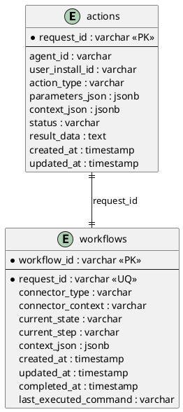
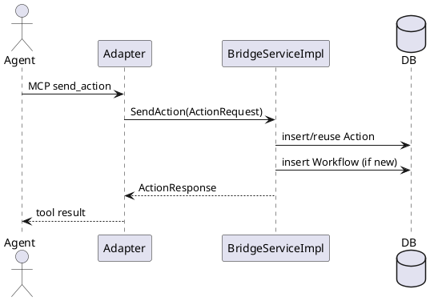
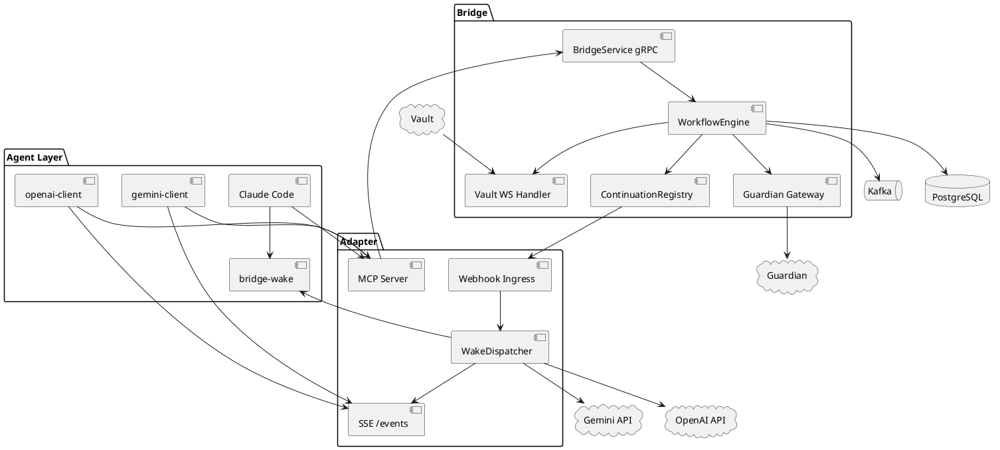
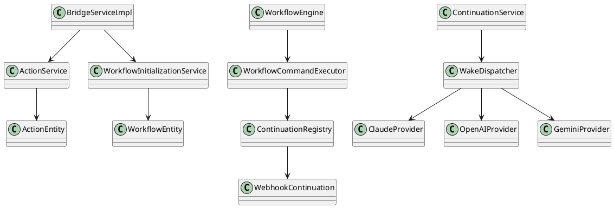
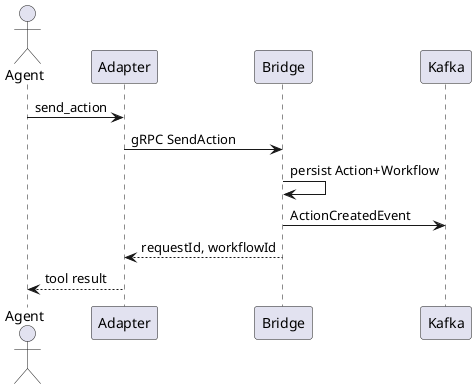
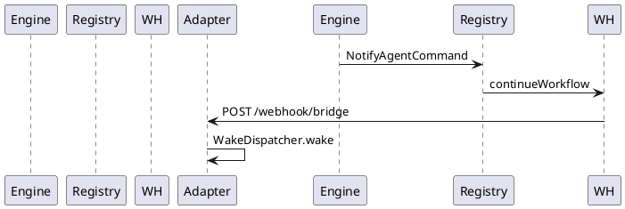
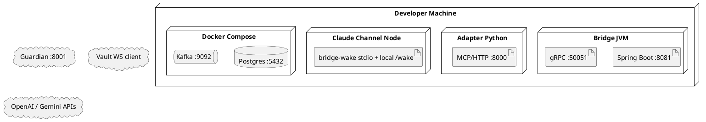

# The Bridge — Complete Technical Documentation

**Document type:** Implementation-based technical documentation (source material for an academic final report)  
**Project:** The Bridge  
**Source of truth:** Current repository code only  
**Rule:** Abandoned designs are omitted. Components that do not exist are stated explicitly. When comments conflict with code, **code wins**.

---

## Table of Contents

1. [Project Overview](#1-project-overview)
2. [High-Level Architecture](#2-high-level-architecture)
3. [Design Philosophy](#3-design-philosophy)
4. [Complete System Flow](#4-complete-system-flow)
5. [Project Structure](#5-project-structure)
6. [Core Classes](#6-core-classes)
7. [Database](#7-database)
8. [Workflow Engine](#8-workflow-engine)
9. [Events](#9-events)
10. [Continuation Layer](#10-continuation-layer)
11. [Adapter](#11-adapter)
12. [Claude Integration](#12-claude-integration)
13. [OpenAI Integration](#13-openai-integration)
14. [Gemini Integration](#14-gemini-integration)
15. [gRPC](#15-grpc)
16. [Protocol Buffers](#16-protocol-buffers)
17. [Security Considerations](#17-security-considerations)
18. [Error Handling](#18-error-handling)
19. [Configuration](#19-configuration)
20. [Technologies](#20-technologies)
21. [UML (PlantUML)](#21-uml-plantuml)
22. [Code Statistics](#22-code-statistics)
23. [TODO / Future Work](#23-todo--future-work)
24. [Final Summary](#24-final-summary)

---

## 1. Project Overview

**The Bridge** is a secure mediation and workflow orchestration layer. It enables AI agents to start long-running actions that depend on external systems (Guardian, Vault), while preserving:

- asynchronous execution,
- durable workflow state,
- and continuation of the original AI conversation after the external work finishes.

The system **separates orchestration from the AI platform**. Agents never talk to Vault/Guardian directly. They talk to an **Adapter** (via MCP). The Adapter talks to **Bridge** (via gRPC). Bridge owns workflow persistence and external integrations. When work completes, Bridge notifies the Adapter with a **webhook**. The Adapter then performs **provider-specific wake/continuation** (Claude Channel, OpenAI Responses, Gemini Interactions).

### What is implemented today

| Capability | Status |
|---|---|
| Bridge gRPC API (`SendAction`, `GetActionStatus`) | Implemented |
| Workflow engine + Kafka events | Implemented |
| PostgreSQL persistence (`actions`, `workflows`) | Implemented |
| Guardian verification (HTTP) | Implemented (external service expected at `:8001`) |
| Vault evaluation (WebSocket) | Implemented (external Vault connects to Bridge) |
| Adapter MCP tools | Implemented |
| Webhook continuation (primary) | Implemented |
| Claude Channel wake (`bridge-wake`) | Implemented |
| OpenAI provider wake + client | Implemented |
| Gemini provider wake + client | Implemented |
| SSE client notification (OpenAI/Gemini clients) | Implemented |
| Agent Notification Service | **Not implemented / does not exist** |
| Polling continuation connector | **Stub only** |
| Thread continuation connector | **Stub only** |

### Explicit non-goals of this document

- Do **not** treat “Agent Notification Service” as a real component.
- Do **not** present polling as the primary architecture.
- Do **not** invent authentication systems that are not in the code.

---

## 2. High-Level Architecture

### 2.1 Final architecture diagram (logical)

```text
┌──────────────────────────────────────────────────────────────────────┐
│                         AI Agent Layer                               │
│  Claude Code (+ bridge-wake) │ openai-client │ gemini-client          │
└───────────────┬──────────────────────┬───────────────────┬───────────┘
                │ MCP tools            │ MCP + SSE         │ MCP + SSE
                ▼                      ▼                   ▼
┌──────────────────────────────────────────────────────────────────────┐
│                         Agent Adapter (Python)                       │
│  MCP (send_action, get_action_status)                                │
│  POST /webhook/bridge                                                │
│  GET  /events (SSE)                                                  │
│  /continuation/* (Claude session registry)                           │
│  WakeDispatcher → ClaudeProvider | OpenAIProvider | GeminiProvider   │
└───────────────┬──────────────────────────────────▲───────────────────┘
                │ gRPC                             │ HTTP webhook
                ▼                                  │
┌──────────────────────────────────────────────────────────────────────┐
│                         Bridge (Kotlin / Spring)                     │
│  BridgeService (gRPC :50051)                                         │
│  ActionService + WorkflowInitializationService                       │
│  WorkflowEngine ← Kafka topic workflow-events                        │
│  GuardianGateway (HTTP) │ VaultGateway (WebSocket /vault-websocket)  │
│  ContinuationRegistry → WEBHOOK (primary) | CHANNEL | POLLING stub   │
│  PostgreSQL: actions, workflows                                      │
└──────────────────────────────────────────────────────────────────────┘
```

### 2.2 Components

#### Agent Adapter
- **Responsibility:** AI-facing façade. Exposes MCP tools; stores local pending workflow context; receives Bridge webhooks; wakes providers; notifies local clients via SSE.
- **Inputs:** MCP tool calls; Bridge webhook JSON; Claude Channel registration; SSE subscriptions.
- **Outputs:** gRPC `SendAction`/`GetActionStatus`; provider wake calls; SSE events; Claude Channel wake forwards.
- **Dependencies:** Bridge gRPC; OpenAI/Gemini APIs (for those providers); Claude Channel process (for Claude).

#### Bridge
- **Responsibility:** Authoritative action acceptance, workflow orchestration, persistence, external system mediation.
- **Inputs:** gRPC requests; Kafka workflow events; Vault WebSocket messages; Guardian HTTP responses (via outbound calls).
- **Outputs:** gRPC responses; Kafka events; Vault WS requests; Guardian HTTP requests; continuation HTTP callbacks.
- **Dependencies:** PostgreSQL, Kafka, Guardian, Vault.

#### Workflow Engine
- **Responsibility:** Event-driven state machine (`WorkflowEngine` + handlers + commands).
- **Inputs:** `WorkflowEvent` from Kafka (and recovery resume path).
- **Outputs:** Commands (transition, verify, vault request, notify, update status, publish event).
- **Dependencies:** DB via repositories/services; Guardian/Vault gateways; continuation registry.

#### Vault
- **Responsibility:** External security black box for payment/action evaluation (biometric/approval/execution decisions are Vault-side).
- **Inputs (from Bridge):** WebSocket `payment_request` messages.
- **Outputs (to Bridge):** `action_approved` / `action_rejected` (or Bridge synthesizes failure if no connection).
- **Dependencies:** Not implemented in this repository; connects as WS client to Bridge `/vault-websocket`.

#### Guardian
- **Responsibility:** External agent verification/trust.
- **Inputs:** Bridge HTTP GET authenticate by agent DID/id.
- **Outputs:** JSON auth response (`status`, `trust_level`) interpreted by Bridge.
- **Dependencies:** External service expected at `http://localhost:8001` (not in this repo).

#### Database
- **Responsibility:** Durable storage for actions and workflows.
- **Technology:** PostgreSQL (`bridge_db`), JPA `ddl-auto=update`.
- **Entities:** `ActionEntity`, `WorkflowEntity`.

#### gRPC layer
- **Responsibility:** Typed Bridge API for Adapter.
- **Service:** `BridgeService` with `SendAction`, `GetActionStatus`.
- **Port:** `50051`.

#### MCP layer
- **Responsibility:** Tool interface for AI agents.
- **Server name:** `bridge-adapter`.
- **Tools:** `send_action`, `get_action_status`.
- **Transports:** stdio or Streamable HTTP (`/mcp`).

#### Claude Channel (`bridge-wake`)
- **Responsibility:** Deliver asynchronous Bridge updates into a live Claude Code session.
- **Inputs:** Adapter POST `/wake` (via continuation registry).
- **Outputs:** MCP notification `notifications/claude/channel`.
- **Dependencies:** Adapter registration endpoints; Claude Code MCP host.

#### Continuation layer
- **Bridge side:** `NotifyAgentCommand` → `ContinuationRegistry` → connector (`WEBHOOK` primary).
- **Adapter side:** webhook ingress → `ContinuationService` → `WakeDispatcher` → provider + optional SSE.
- **Not present:** a separate “Agent Notification Service”.

---

## 3. Design Philosophy

### 3.1 Why introduce Bridge?

Agents should not call Vault/Guardian (or other sensitive systems) directly.

From the implementation shape:

| Concern | How Bridge addresses it |
|---|---|
| **Separation of concerns** | Agent UX/tools live in Adapter; orchestration/security mediation live in Bridge |
| **Orchestration** | Multi-step flow: verify agent → request Vault → notify agent |
| **Workflow persistence** | `workflows` + `actions` tables survive process boundaries |
| **Asynchronous execution** | gRPC returns immediately (`RECEIVED`); work continues via Kafka events |
| **Security mediation** | Bridge is the only component that opens Guardian HTTP and Vault WebSocket channels |

### 3.2 Why Workflow instead of request-response?

Vault and Guardian interactions are not instantaneous. The code models this as a durable workflow:

- **Long-running operations:** action accepted immediately; completion later.
- **Waiting for external events:** Guardian approval/rejection events; Vault WS responses become `ActionResponseReceivedEvent`.
- **Resumable execution:** `WorkflowRecoveryService` resumes unfinished workflows after Spring startup.
- **Tracking state:** `WorkflowState` + `WorkflowStep` persisted on `WorkflowEntity`.
- **Reliability:** Kafka delivery + consumer retry (`FixedBackOff` 2s × 2 retries) + transition validation / event idempotency.

A pure request-response MCP tool call cannot wait for Vault user approval without blocking the agent session or inventing ad-hoc polling loops.

### 3.3 Why Adapter?

Bridge protobuf has **no `platform` field**. Provider identity (`claude` / `openai` / `gemini`) is Adapter-local (`ActionRequestModel.platform`, wake providers).

This keeps Bridge **provider-agnostic**:
- Bridge only knows `connector_type` + opaque `connector_context` (usually webhook URL).
- Adapter owns OpenAI/Gemini API keys, Claude Channel URLs, SSE clients, and conversation/interaction IDs.

### 3.4 Why gRPC?

- Strongly typed service contract (`BridgeService`).
- Generated stubs for Kotlin server and Python client.
- Efficient binary transport suitable for local/service-to-service calls.
- Clear RPC semantics for accept-action vs get-status.

### 3.5 Why Protocol Buffers?

- Single schema (`bridge.proto`) shared across languages.
- Explicit enums (`StatusType`) and maps (`parameters`).
- Forward-compatible field numbering.
- Required by the gRPC stack used in the project.

### 3.6 Why Webhook instead of Polling?

Primary path (`DefaultContinuationProvider`):

- `CONNECTOR_TYPE` defaults to **`WEBHOOK`**
- `CONNECTOR_CONTEXT` defaults to `http://127.0.0.1:8000/webhook/bridge`

Reasons embodied by the design:
- **Lower latency:** Bridge pushes when ready.
- **Fewer useless requests:** no busy-wait against Bridge for every action.
- **Event-driven continuation:** maps naturally to `NotifyAgentCommand`.
- **Scalable wake:** Adapter can fan out to provider-specific wake without Bridge knowing Claude/OpenAI/Gemini.

Polling exists only as:
1. **Bridge stub:** `PollingContinuation` (`// todo`).
2. **Temporary Adapter tool behavior:** `get_action_status` loops up to 20 seconds (`# temporary polling support`).
3. **Optional env override:** `CONNECTOR_TYPE=POLLING` (connector still does not deliver updates).

### 3.7 Why MCP?

MCP is the practical tool interface for modern agent runtimes (Claude Code, and local MCP clients for OpenAI/Gemini wrappers).

Exposed tools:
- **`send_action`** — start Bridge workflow.
- **`get_action_status`** — query status (temporary polling helper).

Agents therefore call a stable tool schema instead of embedding Bridge gRPC details.

### 3.8 Why Claude Channel?

Claude Code sessions are not woken by OpenAI-style conversation append APIs. The project uses Claude’s experimental channel capability:

- local MCP server `bridge-wake` with `claude/channel`,
- HTTP ingress `POST /wake`,
- MCP notification `notifications/claude/channel`.

That is the implemented Claude resume mechanism.

---

## 4. Complete System Flow

### 4.1 Happy path (PAYMENT + WEBHOOK)

1. **Agent** decides to call tool `send_action` (platform + session/continuation context included by client/hooks/channel tool).
2. **MCP `send_action`** enters Adapter (`mcp_server.py`).
3. **Adapter** resolves connector (`WEBHOOK` + callback URL), sets `userInstallId` from `vault_config.json`, stores pending workflow with `continuationContext = sessionId`.
4. **gRPC `SendAction`** to Bridge `:50051`.
5. **Bridge `ActionService`** validates action type; idempotency window 2 minutes; persists `ActionEntity` (`RECEIVED`).
6. **Bridge `WorkflowInitializationService`** persists `WorkflowEntity` (`RECEIVED` / `ACTION_RECEIVED`) and publishes **`ActionCreatedEvent`** to Kafka `workflow-events`.
7. **WorkflowEngine** consumes event → transition to `WAITING_FOR_GUARDIAN` → **`VerifyAgentCommand`**.
8. **Guardian** HTTP authenticate; publishes `GuardianApprovedEvent` or `GuardianRejectedEvent`.
9. On approval → transition `WAITING_FOR_VAULT_RESPONSE` → **`RequestVaultEvaluationCommand`**.
10. **Vault** receives WS `payment_request`; replies approved/rejected.
11. Bridge publishes **`ActionResponseReceivedEvent`**.
12. Handler updates action status, transitions workflow to `COMPLETED`/`FAILED`, issues **`NotifyAgentCommand`**.
13. **WebhookContinuation** POSTs notification to Adapter `/webhook/bridge`.
14. **Adapter `ContinuationService`** loads pending workflow → **`WakeDispatcher`**.
15. **Provider-specific continuation:**
    - Claude → POST continuation URL → Channel `/wake` → Claude notification.
    - OpenAI → `responses.create(conversation=...)` + SSE notify client.
    - Gemini → `interactions.create(previous=...)` + SSE notify with `resumeSessionId`.
16. **Conversation resumes** in the provider’s session model.

### 4.2 Rejection / failure branches

- Illegal action type → Bridge returns `FAILED` description without workflow.
- Guardian reject → workflow `FAILED`; `WorkflowFailedEvent` → notify agent (action row may remain `RECEIVED` because Guardian reject handler does not call `UpdateActionStatusCommand`).
- No Vault WS session → Bridge publishes vault response status `FAILED` with message `No active Vault connection`.
- Unknown request on webhook → Adapter logs warning and returns not-handled.

---

## 5. Project Structure

```text
pii-vault-mcp/
├── src/main/kotlin/          # Bridge
├── src/main/proto/bridge.proto
├── src/main/resources/application.properties
├── build.gradle.kts
├── docker-compose.yml        # Postgres + Kafka infra
├── agent-adapter/            # Adapter + clients + Claude channel
├── docs/                     # Documentation + diagrams
└── .mcp.json                 # Claude MCP server wiring
```

### 5.1 Bridge packages

| Package | Purpose |
|---|---|
| `bridge` | App entry + gRPC service + `ActionService` |
| `bridge.config` | Kafka listener/retry, RestTemplate, WebSocket |
| `bridge.integration` | Guardian/Vault gateway interfaces + adapters |
| `bridge.mapper` | Connector type string mapping |
| `bridge.model` | JPA entities |
| `bridge.repository` | Spring Data repositories |
| `bridge.websocket` | Vault WebSocket handler |
| `bridge.workflow` | Engine, commands, init, recovery, mapper |
| `bridge.workflow.consumer` | Kafka consumer |
| `bridge.workflow.events` | Event types + ActionContext |
| `bridge.workflow.handler` | Per-event handlers |
| `bridge.workflow.publisher` | Kafka publisher |
| `bridge.workflow.state` | Transitions + validation |
| `continuation` | ConnectorType + ContinuationRequest + service interface |
| `connectors.*` | WEBHOOK/CHANNEL/POLLING/THREAD connectors + registry |

### 5.2 Adapter modules

| Path | Purpose |
|---|---|
| `agent-adapter/app` | Adapter runtime |
| `agent-adapter/claude-channel` | Claude Channel MCP server |
| `agent-adapter/openai-client` | OpenAI interactive client |
| `agent-adapter/gemini-client` | Gemini interactive client |
| `agent-adapter/shared_client` | Shared SSE helper |
| `agent-adapter/gemini-bridge-hooks` | Gemini CLI hooks / PoC |

---

## 6. Core Classes

### 6.1 Classes that **do not exist**

| Name in prompt / older designs | Status |
|---|---|
| `ActionEventService` | **Not present** |
| `Agent Notification Service` | **Not present** |
| Adapter DB `WorkflowService` as JPA service | Adapter `WorkflowService` is **in-memory only** |

### 6.2 Bridge core

#### `BridgeServiceImpl`
- **Responsibility:** gRPC entrypoint.
- **Collaborators:** `ActionService`, `WorkflowInitializationService`, `WorkflowRepository`.
- **Methods:** `sendAction`, `getActionStatus`.
- **Lifecycle:** Instantiated as Spring `@Service`; registered into gRPC server in `main`.

#### `ActionService`
- **Responsibility:** Validate/persist/update actions.
- **Collaborators:** `ActionRepository`, `ObjectMapper`.
- **Methods:** `handleAction`, `getActionById`, `updateActionStatus`.
- **Lifecycle:** Creates `ActionEntity` at accept time; updates on Vault outcome commands.

#### `WorkflowInitializationService`
- **Responsibility:** Create workflow row + publish `ActionCreatedEvent`.
- **Collaborators:** `WorkflowRepository`, `WorkflowEventPublisher`.

#### `WorkflowEngine`
- **Responsibility:** Process events; recovery resume.
- **Methods:** `process`, `resume`.
- **Collaborators:** context loader, handlers, command executor, transition validator.

#### `WorkflowCommandExecutor`
- **Responsibility:** Execute command list (side effects).
- **Collaborators:** transition service, Guardian, Vault, event publisher, continuation service, ActionService.

#### `WebhookContinuation` (Bridge)
- **Responsibility:** HTTP callback continuation.
- **Collaborators:** `WebhookTransport`.

#### Repositories
- `ActionRepository` (`@Repository`) — CRUD + `findRecentIdenticalAction`.
- `WorkflowRepository` — CRUD + `findByRequestId` + `findByCurrentStateIn`.

### 6.3 Adapter core

#### `ContinuationService` (Python)
- Handle Bridge webhook notification; wake; cleanup finals.

#### `WakeDispatcher`
- Route to provider by `platform`; then SSE notify.

#### Providers
- `ClaudeProvider`, `OpenAIProvider`, `GeminiProvider` implement `WakeProvider.wake`.

#### `WorkflowService` (Adapter)
- In-memory `pending_workflows: dict[requestId, WorkflowModel]`.

#### `SseClientNotifier`
- Session-routed SSE queues keyed by `(platform, sessionId)`.

#### `ClaudeSessionRegistry`
- Maps Claude session ids to Channel ingress URLs.

### 6.4 Relationships (short)

```text
Agent --MCP--> Adapter.mcp_server
Adapter.main --gRPC--> BridgeServiceImpl
BridgeServiceImpl --> ActionService --> ActionRepository
BridgeServiceImpl --> WorkflowInitializationService --> Kafka
Kafka --> WorkflowEventConsumer --> WorkflowEngine --> Handlers --> Commands
NotifyAgentCommand --> ContinuationRegistry --> WebhookContinuation --> Adapter webhook
Adapter ContinuationService --> WakeDispatcher --> Providers
```

---

## 7. Database

### 7.1 Infrastructure

- Docker Compose service `db`: `postgres:15`, DB `bridge_db`, user/password `user`/`password`, port `5432`.
- JPA auto-update schema.

### 7.2 Entity: `actions` (`ActionEntity`)

| Field | Purpose |
|---|---|
| `request_id` (PK) | Action id returned to callers |
| `agent_id` | Requesting agent identifier |
| `user_install_id` | Installation identity associated with the user/device |
| `action_type` | `PAYMENT` / `TRANSACTION` / `FILL_FORM` |
| `parameters_json` | Action parameters JSON |
| `context_json` | Optional context column (not set in current `ActionService` create path) |
| `status` | Protobuf `StatusType` |
| `result_data` | Final result/message |
| `created_at`, `updated_at` | Timestamps |

**Lifecycle:** created on accept → updated by `UpdateActionStatusCommand` after Vault response.

### 7.3 Entity: `workflows` (`WorkflowEntity`)

| Field | Purpose |
|---|---|
| `workflow_id` (PK) | Internal workflow id |
| `request_id` (unique) | Link to action |
| `connector_type` | Continuation strategy |
| `connector_context` | Opaque connector data (webhook URL, etc.) |
| `current_state` | WorkflowState |
| `current_step` | WorkflowStep |
| `context_json` | Serialized ActionContext |
| `created_at`, `updated_at`, `completed_at` | Timestamps |
| `last_executed_command` | Optional audit field |

**Relationship:** logical **1:1** with `actions` via `request_id`. **No JPA `@OneToOne` annotation.**

### 7.4 ER Diagram (PlantUML)



---

## 8. Workflow Engine

### 8.1 Action vs Workflow

- **Action:** agent-visible record (`StatusType`).
- **Workflow:** internal orchestration record (`WorkflowState`, `WorkflowStep`).

### 8.2 States

`RECEIVED` → `WAITING_FOR_GUARDIAN` → `WAITING_FOR_VAULT_RESPONSE` → (`IN_PROGRESS`) → `COMPLETED` | `FAILED`

Allowed transitions are enforced by `WorkflowTransitionValidator` (see implementation). Terminal states set `completedAt` and force step `FINISHED` in `WorkflowTransitionService`.

### 8.3 Steps

`ACTION_RECEIVED`, `VERIFY_AGENT`, `REQUEST_VAULT_EVALUATION`, `WAIT_FOR_VAULT_RESPONSE`, `NOTIFY_AGENT`, `FINISHED`.

### 8.4 Persistence

Every transition is saved through `WorkflowRepository`.

### 8.5 Failure handling

- Illegal transitions throw `IllegalStateException`.
- Guardian/Vault failures produce failed workflow paths and notify commands where coded.
- Duplicate/out-of-order events ignored via `shouldProcessEvent`.

### 8.6 Retry / recovery (implemented)

| Mechanism | Behavior |
|---|---|
| Kafka consumer retry | `FixedBackOff(2000ms, 2)` → 3 attempts total |
| Startup recovery | `WorkflowRecoveryScheduler` on `ApplicationReadyEvent` resumes unfinished workflows |
| `IN_PROGRESS` recovery | Currently **no commands** (explicit log: not defined yet) |

---

## 9. Events

Kafka topic: **`workflow-events`**.

| Event | Publisher | Consumer handler | Trigger | Key payload fields |
|---|---|---|---|---|
| `ActionCreatedEvent` | `WorkflowInitializationService` | `ActionCreatedEventHandler` | New workflow | `context` |
| `GuardianApprovedEvent` | `GuardianGatewayAdapter` | `GuardianApprovedEventHandler` | Guardian verified | `context`, `trustLevel` |
| `GuardianRejectedEvent` | `GuardianGatewayAdapter` | `GuardianRejectedEventHandler` | Guardian reject/error | `context`, `reason` |
| `ActionResponseReceivedEvent` | `VaultWebSocketHandler` | `ActionResponseReceivedEventHandler` | Vault WS result / no session | `responseStatus`, `resultData`, `context` |
| `WorkflowCompletedEvent` | ActionResponse handler (`PublishEventCommand`) | `WorkflowCompletedEventHandler` | Success path publish | `context` |
| `WorkflowFailedEvent` | GuardianRejected / ActionResponse handlers | `WorkflowFailedEventHandler` | Failure path publish | `context`, `failureReason` |

**Event flow:** publish JSON → Kafka → `WorkflowEventConsumer` → `WorkflowEngine.process` → handler → commands.

**Implementation note:** `WORKFLOW_COMPLETED`/`WORKFLOW_FAILED` are accepted only in state `IN_PROGRESS`. Because `ActionResponseReceivedEventHandler` often transitions directly to `COMPLETED`/`FAILED` before publishing those events, follow-up handlers may be skipped by idempotency checks. Notify commonly already happened in the ActionResponse handler.

---

## 10. Continuation Layer

### Strategy actually used

**Primary:** `WEBHOOK` (Adapter default).

### Bridge components

| Component | Role | Implemented? |
|---|---|---|
| `NotifyAgentCommand` | Command to continue agent | Yes |
| `ContinuationRegistry` | Dispatch by connector type | Yes |
| `WebhookContinuation` | POST callback | Yes |
| `ChannelContinuation` | POST NotifyAgent to endpoint | Yes (HTTP) |
| `PollingContinuation` | Placeholder | Stub (`todo`) |
| `ThreadContinuation` | Placeholder | Stub (`todo`) |

### Adapter components

| Component | Role |
|---|---|
| Python `WebhookContinuation` | Receive Bridge POST |
| `ContinuationService` | Correlate + wake + cleanup |
| `WakeDispatcher` | Provider routing + SSE notify |

**No Agent Notification Service exists.** Continuation is Bridge webhook + Adapter wake stack.

---

## 11. Adapter

### MCP server
- Name: `bridge-adapter`
- Tools: `send_action`, `get_action_status`
- Transport: `MCP_TRANSPORT=stdio|http`

### `send_action`
Builds Bridge request with connector settings; stores pending workflow (`platform`, `continuationContext=sessionId`).

### `get_action_status`
Temporary poll loop (max ~20s) against Bridge `GetActionStatus`.

### Webhook endpoint
`POST /webhook/bridge` → continuation handling.

### SSE endpoint
`GET /events?platform=...&sessionId=...` → `SseClientNotifier`.

### Provider abstraction
`WakeProvider` interface; registered map in `workflow_context.py`.

### Session mapping
- Claude: `ClaudeSessionRegistry` + `/continuation/{id}`
- OpenAI: conversation id as sessionId
- Gemini: interaction id as sessionId (rotates on wake)

### Conversation continuation
Performed by providers (see §12–14), not by Bridge.

---

## 12. Claude Integration

### Components
- MCP server **`bridge-wake`** (`agent-adapter/claude-channel/server.ts`)
- `.mcp.json` entry launching `tsx .../server.ts`
- Adapter continuation register/forward endpoints

### Flow
1. Channel starts, binds local `/wake`, registers with Adapter.
2. Claude calls `get_continuation_context` and uses returned `continuationUrl` as `send_action.sessionId` (`platform=claude`).
3. On Bridge completion, Adapter `ClaudeProvider` POSTs wake payload to continuation URL.
4. Adapter forwards to Channel `POST /wake`.
5. Channel emits `notifications/claude/channel` with textual content + meta.
6. Claude Code surfaces the channel update and the model continues the workflow in-session.

---

## 13. OpenAI Integration

### Wake
`OpenAIProvider.wake`:
- requires `OPENAI_API_KEY`
- calls `client.responses.create(model=OPENAI_MODEL, conversation=conversation_id, input=bridge_update_text)`
- `conversation_id` is Adapter `continuationContext` (stable `conv_...`)

### Client (`openai-client`)
- Owns conversation bootstrap/persistence.
- Uses local MCP client against Adapter `/mcp` (hosted remote MCP cannot reach localhost).
- Subscribes to SSE `/events`.
- After notify, fetches new Conversations API items and prints them.

---

## 14. Gemini Integration

### Wake
`GeminiProvider.wake`:
- requires `GEMINI_API_KEY` or `GOOGLE_API_KEY`
- `interactions.create(model=..., previous_interaction_id=..., input=...)`
- updates Adapter pending workflow continuation to **new** interaction id

### Client (`gemini-client`)
- Owns interaction bootstrap.
- MCP + SSE similar to OpenAI client.
- Handles `resumeSessionId` rotation after wake.
- Optional Gemini CLI hooks under `gemini-bridge-hooks` for session/tool bootstrap.

---

## 15. gRPC

### Service: `BridgeService`

#### RPC `SendAction`
- **Request `ActionRequest`:** `agent_id`, `user_install_id`, `action_type`, `parameters`, `connector_type`, `connector_context`
- **Response `ActionResponse`:** `request_id`, `status`, `description`, `workflow_id`
- **Behavior:** persist action + init workflow (or reuse idempotent/existing workflow)

#### RPC `GetActionStatus`
- **Request `StatusRequest`:** `request_id`
- **Response `StatusResponse`:** proto defines `request_id`, `status`, `result_data`, `updated_at`
- **Implementation:** currently sets `requestId` + `status` only

### Sequence (send_action)



---

## 16. Protocol Buffers

File: `src/main/proto/bridge.proto`

### Service
`BridgeService` (2 RPCs above).

### Messages
- `ActionRequest`, `ActionResponse`, `StatusRequest`, `StatusResponse`

### Enum `StatusType`
`UNSPECIFIED`, `RECEIVED`, `WAITING_FOR_USER`, `IN_PROGRESS`, `COMPLETED`, `FAILED`, `REJECTED`, `EXPIRED`, `FAILED_APP_NOT_INSTALLED`.

**Not in proto:** `UNTRUSTED` (appears only as Adapter final-status string).

---

## 17. Security Considerations

### Implemented mediation properties
- Bridge is the mediation point to Guardian and Vault.
- Adapter isolates provider credentials (`OPENAI_API_KEY`, `GEMINI_API_KEY`) from Bridge.
- Actions carry `user_install_id` associating requests with an installation identity.
- Claude Channel registration accepts only local `http://127.0.0.1|localhost/.../wake` ingress URLs.

### Current limitations (explicit)
- gRPC channel is **insecure** (`grpc.insecure_channel`, no TLS) — noted in Adapter `main.py` comments as non-production.
- No OAuth/JWT middleware is implemented on Adapter HTTP routes.
- `IdentityProvider` exists and mentions possible future OAuth/session sources in a docstring, but `send_action` currently uses `vault_config.json` `userInstallId` directly.
- WebSocket endpoint allows all origins (`setAllowedOrigins("*")`).
- No end-to-end auth between Agent ↔ Adapter ↔ Bridge beyond trusting local deployment topology.

---

## 18. Error Handling

| Case | Behavior in code |
|---|---|
| Unknown action type | `ActionService` returns FAILED response description |
| Action handling exception | `BridgeServiceImpl` returns FAILED safety-layer description |
| Workflow init failure | gRPC `INTERNAL` with description |
| Missing action on GetStatus | gRPC `NOT_FOUND` |
| Duplicate action (2 min) | Reuse existing action/workflow ids |
| Illegal workflow transition | `IllegalStateException` |
| Out-of-order/duplicate event | Ignored by `shouldProcessEvent` |
| Guardian HTTP failure | Publish `GuardianRejectedEvent` |
| No Vault WS | Publish ActionResponse status `FAILED` |
| Adapter webhook unknown requestId | Warning; not handled |
| Claude Channel unreachable | Adapter unregisters session; HTTP 502 |
| Provider wake missing API key / context | Raises error in provider |
| Kafka handler failures | Retried via `DefaultErrorHandler` FixedBackOff |
| `get_action_status` still running | Returns “still running” after 20 polls |

Timeouts present: Claude wake HTTP timeout **5 seconds**; SSE client uses infinite HTTP timeout for long-lived stream.

---

## 19. Configuration

### Bridge (`application.properties`)
- Postgres URL/credentials
- `server.port` default **8081**
- Kafka bootstrap `localhost:9092`, group `bridge-group`
- gRPC port hard-coded **50051** in `GrpcServer.kt`

### Adapter environment
| Variable | Default / role |
|---|---|
| `MCP_TRANSPORT` | `stdio` or `http` |
| `ADAPTER_HOST` | `0.0.0.0` |
| `ADAPTER_PORT` | `8000` |
| `ADAPTER_PUBLIC_BASE` | public base for Claude continuation URLs |
| `CONNECTOR_TYPE` | default `WEBHOOK` |
| `CONNECTOR_CONTEXT` | default webhook URL |
| `OPENAI_API_KEY` / `OPENAI_MODEL` | OpenAI wake |
| `GEMINI_API_KEY` or `GOOGLE_API_KEY` / `GEMINI_MODEL` | Gemini wake |
| `ADAPTER_LOG_LEVEL` | logging |

### Claude Channel env
- `ADAPTER_BASE_URL` (default `http://127.0.0.1:8000`)
- `CHANNEL_PORT` optional; else ephemeral

### Files
- `agent-adapter/app/vault_config.json` → `userInstallId` (and unused `agentId` key for IdentityProvider)
- `.mcp.json` → Claude MCP servers
- `docker-compose.yml` → db/kafka/zookeeper/kafka-ui

### Startup sequence (typical)
1. `docker compose up` (Postgres/Kafka)
2. `./gradlew run` (Bridge Spring + gRPC)
3. Vault connects to `ws://localhost:8081/vault-websocket` (external)
4. Guardian available at `:8001` (external)
5. `python adapter.py` with desired transport/env
6. Start agent client / Claude Code (and bridge-wake via MCP)

---

## 20. Technologies

| Technology | Used for | Why (from architecture) |
|---|---|---|
| Kotlin + Spring Boot | Bridge server | DI, JPA, Kafka, WebSocket, scheduling |
| Python + FastAPI/Uvicorn/FastMCP | Adapter | Rapid MCP + HTTP webhook/SSE |
| gRPC + Protobuf | Adapter↔Bridge API | Typed cross-language contract |
| PostgreSQL | Durable action/workflow state | Persistence/recovery |
| Kafka | Workflow event bus | Async decoupling + retries |
| MCP | Agent tool interface | Native to agent hosts |
| Webhook HTTP | Bridge→Adapter continuation | Push, low latency |
| SSE | Adapter→local clients notify | OpenAI/Gemini UI clients |
| WebSocket | Vault protocol | Existing Vault channel model |
| OpenAI / Google GenAI SDKs | Provider wake | Conversation/interaction continuation |
| Node/tsx + MCP TS SDK | Claude Channel | Claude channel notifications |
| Docker Compose | Infra only | Local Postgres/Kafka |
| App Dockerfiles | — | **Not present** |

---

## 21. UML (PlantUML)

### 21.1 Component Diagram



### 21.2 Class Diagram (core)



### 21.3 Sequence — send_action



### 21.4 Sequence — webhook continuation



### 21.5 Sequence — Claude wake-up

```plantuml
@startuml
Participant Adapter
Participant Channel as bridge-wake
Participant Claude

Adapter -> Adapter: ClaudeProvider.wake
Adapter -> Channel: POST /wake
Channel -> Claude: notifications/claude/channel
@enduml
```

### 21.6 Deployment Diagram



---

## 22. Code Statistics

Approximate inventory from current source (Kotlin under `src/main/kotlin`, proto, Adapter excluding `node_modules`):

| Metric | Count |
|---|---:|
| Kotlin packages | 20 |
| Kotlin types (class/interface/object/enum) | ~72 |
| `@Service` | 9 |
| `@Component` | 21 |
| `@Repository` annotations | 1 (`ActionRepository`; `WorkflowRepository` exists without annotation) |
| `@Controller` / `@RestController` | 0 |
| Entities | 2 |
| gRPC services | 1 |
| gRPC RPCs | 2 |
| Proto messages | 4 |
| Proto enums | 1 |
| Workflow event types | 6 |
| Workflow states | 6 |
| Workflow steps | 6 |
| Workflow command sealed types | 6 |
| Continuation connectors | 4 (2 stubs) |
| Adapter MCP tools | 2 |
| Wake providers | 3 (+ `google` alias) |
| Docker Compose services | 4 |

---

## 23. TODO / Future Work

### Implemented
- Bridge accept/status RPCs
- Workflow engine + Kafka
- Guardian + Vault integration paths
- WEBHOOK continuation
- Adapter MCP + webhook + SSE
- Claude Channel wake
- OpenAI/Gemini providers and sample clients
- Startup workflow recovery (partial)

### Partially implemented
- `get_action_status` temporary polling loop
- `ChannelContinuation` (HTTP sender exists; not Adapter’s default path)
- Workflow recovery for `IN_PROGRESS` (no commands yet)
- `IdentityProvider` abstraction (file exists; send_action uses config constant)
- `GetActionStatus` response fields (`result_data`, `updated_at` not populated by impl)

### Planned / stub only (in code)
- `PollingContinuation` TODO body
- `ThreadContinuation` TODO body
- Production-secure gRPC (commented as needed; not implemented)
- Possible future identity sources (OAuth/session) mentioned in `IdentityProvider` docstring only

### Explicitly not part of final architecture
- Agent Notification Service as a standalone service

---

## 24. Final Summary

The Bridge final implementation is an **asynchronous mediation architecture**:

1. AI agents use **MCP tools** on an **Adapter**.
2. The Adapter calls a **provider-agnostic Bridge** over **gRPC/Protobuf**.
3. Bridge persists **Actions** and **Workflows**, orchestrates **Guardian** and **Vault**, and advances state through a **Kafka-backed workflow engine**.
4. When work finishes, Bridge continues the agent via **webhook** (not a separate notification microservice).
5. The Adapter performs **provider-specific wake**:
   - Claude via **Claude Channel** notifications,
   - OpenAI via **Responses + Conversations**,
   - Gemini via **Interactions**,
   with SSE notify for local OpenAI/Gemini clients.

This differs from a traditional request-response AI tool call: the agent receives an immediate accept (`requestId`/`workflowId`), the sensitive long-running work happens outside the model loop, and the original conversation is resumed later through an explicit continuation path.

Polling is only a compatibility/temporary helper. Webhooks plus Adapter wake are the real continuation mechanism in the current codebase.

---

*End of document. All claims are tied to the current repository implementation.*
