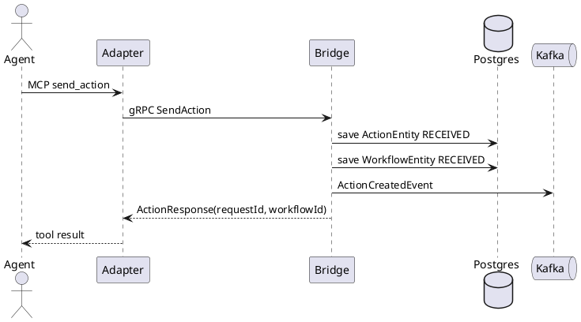
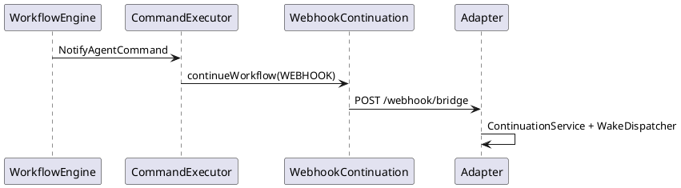
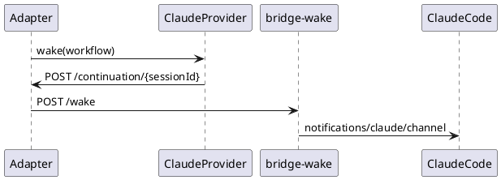
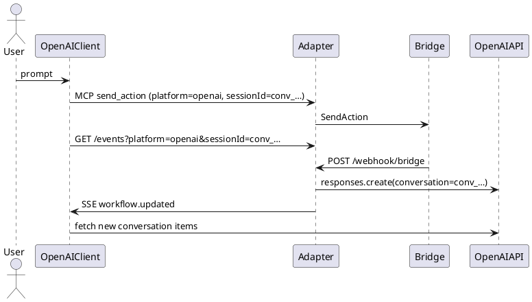
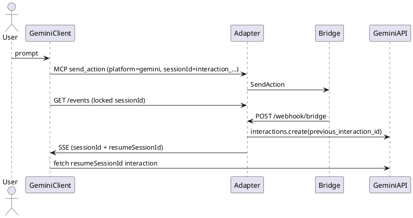
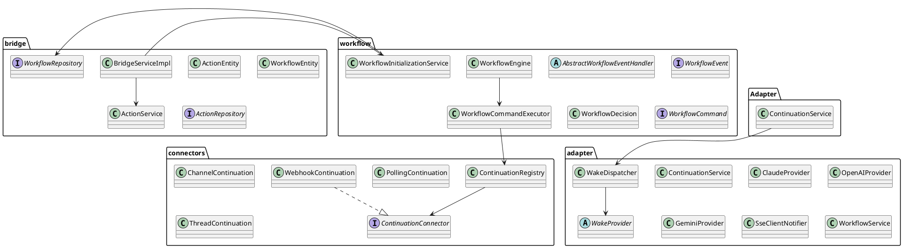
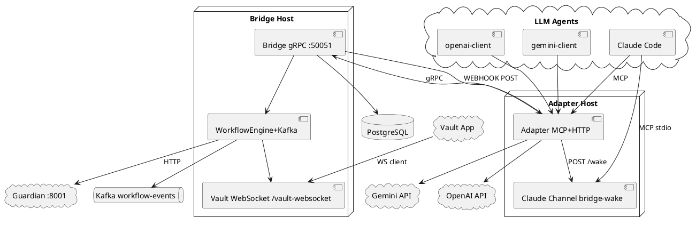
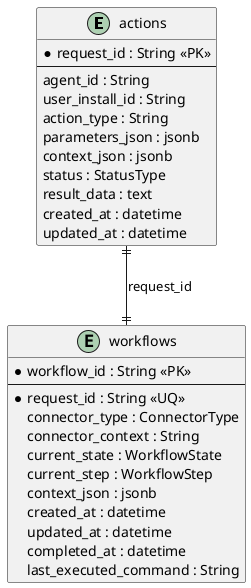

# The Bridge — Technical Implementation Reference

> **Purpose:** Factual inventory of the **current** codebase for academic report writing.  
> **Scope:** Only what exists in the repository now. No deleted designs. No speculation.  
> **Rule:** If something is absent from code, it is stated explicitly as **not present**.  
> **Generated from:** `src/main/kotlin`, `src/main/proto`, `src/main/resources`, `agent-adapter/`, `docker-compose.yml`, `build.gradle.kts`, `.mcp.json`.

---

## 1. Architecture

### 1.1 Final architecture (as implemented)

The system is split into two primary runnable programs plus optional agent clients:

| Component | Location | Runtime | Role |
|---|---|---|---|
| **Bridge** | `src/main/kotlin` | Kotlin / Spring Boot | Authoritative action + workflow engine; gRPC API; Kafka; PostgreSQL; Vault WebSocket; Guardian HTTP |
| **Adapter** | `agent-adapter/app` | Python | MCP tools for agents; gRPC client to Bridge; webhook receiver; platform wake; SSE client notify |
| **Claude Channel (`bridge-wake`)** | `agent-adapter/claude-channel/server.ts` | Node / MCP stdio | Local HTTP `/wake` + Claude `notifications/claude/channel` |
| **OpenAI client** | `agent-adapter/openai-client` | Python | Standalone chat client using Adapter MCP + SSE |
| **Gemini client** | `agent-adapter/gemini-client` | Python | Standalone chat client using Adapter MCP + SSE |
| **Gemini bridge hooks** | `agent-adapter/gemini-bridge-hooks` | Node hooks + optional PoC | Session bootstrap / BeforeTool hooks for Gemini CLI |
| **Infrastructure** | `docker-compose.yml` | Docker Compose | PostgreSQL, Zookeeper, Kafka, Kafka UI |

External systems referenced by Bridge code (not implemented in this repo):

| External | How Bridge talks to it | Code |
|---|---|---|
| **Guardian** | HTTP `RestTemplate` to `http://localhost:8001/v1/authenticate/agent?did=` and `/v1/report` | `GuardianGatewayAdapter` |
| **Vault** | WebSocket endpoint `/vault-websocket` on Bridge HTTP port | `VaultWebSocketHandler` |

### 1.2 Component responsibilities

**Bridge**
- Accept `SendAction` / `GetActionStatus` over gRPC `:50051`.
- Persist `actions` and `workflows` in PostgreSQL.
- Publish/consume workflow events on Kafka topic `workflow-events`.
- Drive state machine via `WorkflowEngine` + handlers + commands.
- Call Guardian (verify agent) and Vault (payment evaluation).
- Continue the agent via `ContinuationRegistry` (`WEBHOOK` / `CHANNEL` / `POLLING` / `THREAD`).

**Adapter**
- Expose MCP tools `send_action`, `get_action_status`.
- Map tool calls → gRPC `SendAction` / `GetActionStatus`.
- Store in-memory pending workflows keyed by `requestId` (not DB).
- Receive Bridge continuation at `POST /webhook/bridge`.
- Wake platform-specific agents (`ClaudeProvider`, `GeminiProvider`, `OpenAIProvider`).
- Notify local OpenAI/Gemini clients via SSE `GET /events`.
- Register Claude Channel sessions at `/continuation/register` and forward wakes.

**Claude Channel**
- MCP server named `bridge-wake` with capability `claude/channel`.
- Registers ingress URL with Adapter; exposes `get_continuation_context`.
- On `POST /wake`, emits MCP notification `notifications/claude/channel`.

### 1.3 How components communicate

```
Agent/LLM
  --MCP--> Adapter (/mcp or stdio)
             --gRPC--> Bridge :50051
                         --Kafka--> WorkflowEngine
                         --HTTP--> Guardian :8001
                         --WebSocket--> Vault client
                         --HTTP POST--> Adapter /webhook/bridge  (WEBHOOK connector)
Adapter
  --HTTP POST--> Claude Channel /wake  OR OpenAI/Gemini cloud APIs
  --SSE--> openai-client / gemini-client
```

Default connector from Adapter (`DefaultContinuationProvider`):
- `CONNECTOR_TYPE` default **`WEBHOOK`**
- `CONNECTOR_CONTEXT` default **`http://127.0.0.1:8000/webhook/bridge`**

### 1.4 Modules that exist

**Bridge (Kotlin packages):** `bridge`, `bridge.config`, `bridge.integration`, `bridge.mapper`, `bridge.model`, `bridge.repository`, `bridge.websocket`, `bridge.workflow` (+ `consumer`, `events`, `handler`, `publisher`, `state`), `connectors.api`, `connectors.channel`, `connectors.polling`, `connectors.registry`, `connectors.thread`, `connectors.webhook`, `continuation`.

**Adapter (Python):** `agent-adapter/app` with `continuation/`, `transport/`, `workflow/`, `bridge/`.

**Clients:** `openai-client`, `gemini-client`, `shared_client`, `claude-channel`, `gemini-bridge-hooks`.

### 1.5 Services that exist

| Service-like unit | Exists? | Notes |
|---|---|---|
| Bridge gRPC `BridgeService` | Yes | `SendAction`, `GetActionStatus` |
| Bridge Spring Boot app | Yes | HTTP `:8081` (WS + config) + gRPC `:50051` |
| Adapter MCP server `bridge-adapter` | Yes | FastMCP |
| Adapter webhook / SSE HTTP | Yes | Same process as Adapter |
| Claude Channel MCP `bridge-wake` | Yes | Separate Node process |
| Kafka `workflow-events` | Yes | Publisher + consumer in Bridge |
| PostgreSQL `bridge_db` | Yes | via docker-compose + JPA |
| Guardian | External only | Called by Bridge; **not in this repo** |
| Vault | External only | Connects as WS client to Bridge; **not in this repo** |

### 1.6 Services planned / named but **not present** as code

| Name | Status in repo |
|---|---|
| **Agent Notification Service** | **Not present.** No class, package, or binary with this name. Continuation is `WebhookContinuation` (Bridge) + `ContinuationService`/`WakeDispatcher`/`SseClientNotifier` (Adapter). |
| Dedicated Polling service | **Not present.** `PollingContinuation` is a stub (`// todo`). |
| Thread continuation service | **Not present as working logic.** `ThreadContinuation` logs + `// todo`. |
| Dockerfile for Bridge/Adapter app images | **Not present.** Only `docker-compose.yml` for infra. |
| Spring `@RestController` / `@Controller` API for agents | **Not present.** Agent API is gRPC only. |

---

## 2. Project Structure

### 2.1 Top-level layout

```
pii-vault-mcp/
  src/main/kotlin/          # Bridge
  src/main/proto/bridge.proto
  src/main/resources/application.properties
  build.gradle.kts
  docker-compose.yml
  agent-adapter/            # Adapter + clients + Claude channel
  docs/                     # Diagrams + this document
  .mcp.json                 # Claude MCP server entries
```

### 2.2 Bridge packages

#### `bridge`
- **`BridgeServerApplication` / `main` (`GrpcServer.kt`)**: Spring Boot entry; starts gRPC server on **50051** with `BridgeServiceImpl`.
- **`BridgeServiceImpl`**: gRPC implementation; calls `ActionService`, `WorkflowInitializationService`, `WorkflowRepository`.
- **`ActionService`**: Validate action type; idempotent persist; get/update action status. Uses `ActionRepository`.

#### `bridge.config`
- **`KafkaListenerConfig`**: Kafka listener container factory.
- **`KafkaRetryConfig`**: Kafka retry configuration.
- **`RestTemplateConfig`**: `RestTemplate` bean (Guardian HTTP).
- **`WebSocketConfig`**: Registers `/vault-websocket` → `VaultWebSocketHandler`.

#### `bridge.integration`
- **`GuardianGateway`** (interface): `verifyAgent(...)`.
- **`GuardianGatewayAdapter`**: HTTP authenticate; publishes `GuardianApprovedEvent` / `GuardianRejectedEvent`; also `verifyAgentSync`, `reportOutcome`.
- **`VaultGateway`** (interface): `requestApproval(...)`.
- **`VaultGatewayAdapter`**: Delegates to `VaultWebSocketHandler.sendRequestToVault`.
- **`AuthResponse`**: DTO `status`, `trust_level`.

#### `bridge.mapper`
- **`ConnectorTypeMapper.kt`**: Extension `String.toConnectorType()` mapping `"POLLING"|"CHANNEL"|"THREAD"|"WEBHOOK"`.

#### `bridge.model`
- **`ActionEntity`**, **`WorkflowEntity`**: JPA entities (see §5).

#### `bridge.repository`
- **`ActionRepository`**: `@Repository` + `findRecentIdenticalAction`.
- **`WorkflowRepository`**: `findByRequestId`, `findByCurrentStateIn` (no `@Repository` annotation; still a Spring Data interface).

#### `bridge.websocket`
- **`VaultWebSocketHandler`**: Vault protocol; publishes `ActionResponseReceivedEvent`.

#### `bridge.workflow`
- Engine core: `WorkflowEngine`, `WorkflowCommandExecutor`, `WorkflowInitializationService`, `WorkflowContext`, `WorkflowContextLoader`, `WorkflowDecision`, `WorkflowCommand` (+ sealed command types), `WorkflowCommandType`, `WorkflowEventMapper`, `WorkflowRecoveryService`, `WorkflowRecoveryScheduler`.
- Enums: `WorkflowState`, `WorkflowStep`, `WorkflowEventType` (file under `events/` but package `bridge.workflow`).

#### `bridge.workflow.consumer`
- **`WorkflowEventConsumer`**: `@KafkaListener` topic `workflow-events` → `WorkflowEngine.process`.

#### `bridge.workflow.events`
- `WorkflowEvent`, `ActionContext`, and six event data classes (see §9).

#### `bridge.workflow.handler`
- `WorkflowEventHandler`, `AbstractWorkflowEventHandler`, and six concrete handlers.

#### `bridge.workflow.publisher`
- `WorkflowEventPublisher`, `KafkaWorkflowEventPublisher` (topic `workflow-events`).

#### `bridge.workflow.state`
- `WorkflowTransitionService`, `WorkflowTransitionValidator`.

#### `continuation`
- `ConnectorType`, `ContinuationRequest`, `WorkflowContinuationService`.

#### `connectors.*`
- `ContinuationConnector`, `ContinuationRegistry`.
- `WebhookContinuation` + `WebhookTransport` + `WebhookNotification`.
- `ChannelContinuation` + `HttpChannelTransport` + `ChannelTransport` + `NotifyAgent`.
- `PollingContinuation` (stub), `ThreadContinuation` (stub).

### 2.3 Adapter structure (Python)

| Path | Purpose |
|---|---|
| `adapter.py` | Process entry: MCP stdio+webhook **or** MCP HTTP |
| `mcp_server.py` | FastMCP tools + custom HTTP routes |
| `server.py` | FastAPI app used when `MCP_TRANSPORT=stdio` (webhook + events) |
| `main.py` | gRPC client helpers `send_action` / `get_status` |
| `mapper.py` | `ActionRequestModel` → protobuf |
| `continuation/*` | Wake + notify stack |
| `transport/*` | Shared webhook/SSE handlers |
| `workflow/*` | In-memory pending workflows + models |
| `bridge/*` | Generated/legacy gRPC stubs + `BridgeClient` |

---

## 3. Complete Flow

End-to-end happy path with default `CONNECTOR_TYPE=WEBHOOK` and a PAYMENT action.

### 3.1 Agent → Adapter

1. Agent (Claude Code / openai-client / gemini-client) calls MCP tool **`send_action`** with:
   - `agentId`, `actionType`, `parameters`, `sessionId`, `platform`
2. Adapter resolves continuation target (`WEBHOOK` + callback URL).
3. Adapter builds `ActionRequestModel` with `connectorType`/`connectorContext` for Bridge, and stores `sessionId` as local `continuationContext`.
4. Adapter calls Bridge gRPC **`SendAction`**.

### 3.2 Adapter → Bridge (`SendAction`)

1. `BridgeServiceImpl.sendAction`:
   - `ActionService.handleAction` validates type ∈ {`PAYMENT`,`TRANSACTION`,`FILL_FORM`}.
   - Idempotency: reuse action if same agent/type/parameters within 2 minutes.
   - Else create `ActionEntity` status `RECEIVED`.
2. If workflow already exists for `request_id`, return existing `workflowId` (no second init).
3. Else `WorkflowInitializationService.initializeWorkflow`:
   - Persist `WorkflowEntity` state `RECEIVED`, step `ACTION_RECEIVED`.
   - Publish **`ActionCreatedEvent`** to Kafka.

### 3.3 Workflow engine

1. `WorkflowEventConsumer` → `WorkflowEngine.process`.
2. **`ACTION_CREATED`** → `ActionCreatedEventHandler`:
   - Transition → `WAITING_FOR_GUARDIAN` / step `VERIFY_AGENT`
   - `VerifyAgentCommand` → Guardian HTTP.

### 3.4 Guardian

1. `GuardianGatewayAdapter.verifyAgent` GET `localhost:8001/v1/authenticate/agent?did={agentId}`.
2. If `status == "verified"` → publish **`GuardianApprovedEvent`**.
3. Else / on error → publish **`GuardianRejectedEvent`**.

**Approved path:**
- Handler transitions → `WAITING_FOR_VAULT_RESPONSE` / `REQUEST_VAULT_EVALUATION`
- `RequestVaultEvaluationCommand` → Vault WebSocket `payment_request`.

**Rejected path:**
- Transition → `FAILED` / `FINISHED`
- Publish **`WorkflowFailedEvent`**
- (ActionEntity status is **not** updated in this handler path.)
- `WorkflowFailedEventHandler` issues **`NotifyAgentCommand`**.

### 3.5 Vault

1. Bridge keeps one `WebSocketSession` after Vault `connection_init` / `connection_ack`.
2. `sendRequestToVault` sends Base64 payload (`amount;currency;timestamp`).
3. Vault replies `action_approved` or `action_rejected` (or Bridge synthesizes `FAILED` if no session).
4. Handler publishes **`ActionResponseReceivedEvent`**.

### 3.6 Action response → completion

`ActionResponseReceivedEventHandler`:

| Vault `responseStatus` | Workflow state | Action StatusType | Side effects |
|---|---|---|---|
| `APPROVED` / `COMPLETED` / `SUCCESS` | `COMPLETED` | `COMPLETED` | Publish `WorkflowCompletedEvent`, `NotifyAgentCommand` |
| `REJECTED` | `FAILED` | `REJECTED` | Publish `WorkflowFailedEvent`, `NotifyAgentCommand` |
| else | `FAILED` | `FAILED` | Publish `WorkflowFailedEvent`, `NotifyAgentCommand` |

Note from code: `shouldProcessEvent` for `WORKFLOW_COMPLETED` / `WORKFLOW_FAILED` requires state `IN_PROGRESS`. After the handler above, state is already `COMPLETED`/`FAILED`, so those follow-up events are typically **ignored** by `WorkflowEngine` (idempotency). Notify already ran in `ActionResponseReceivedEventHandler`.

### 3.7 Continuation → Webhook

`NotifyAgentCommand` → `WorkflowCommandExecutor` → `WorkflowContinuationService.continueWorkflow` (`ContinuationRegistry`) with `connectorType` from action context.

For **WEBHOOK**:
- `WebhookContinuation.continueWorkflow` → `WebhookTransport.send` POST JSON `WebhookNotification` to `connectorContext` URL.

### 3.8 Adapter webhook → Wake

1. `POST /webhook/bridge` → `process_bridge_webhook` → Python `WebhookContinuation.handle` → `ContinuationService.handle`.
2. Load pending `WorkflowModel` by `requestId`; update status; call `WakeDispatcher.wake`.
3. Provider by `platform`:
   - **claude** → `ClaudeProvider`: HTTP POST to `continuationContext` (continuation URL).
   - **openai** → `OpenAIProvider`: `responses.create(conversation=continuationContext, ...)`.
   - **gemini**/`google` → `GeminiProvider`: `interactions.create(previous_interaction_id=...)`; updates stored continuation to new interaction id.
4. Then `SseClientNotifier.notify` for OpenAI/Gemini clients subscribed to `(platform, sessionId)`.
5. On final statuses (`COMPLETED`,`REJECTED`,`FAILED`,`FAILED_APP_NOT_INSTALLED`,`UNTRUSTED`) remove pending workflow from Adapter memory.

### 3.9 Claude / OpenAI / Gemini resume

- **Claude:** Adapter may POST `/continuation/{sessionId}` which forwards to Channel `/wake`; Channel emits `notifications/claude/channel` into Claude Code session.
- **OpenAI:** Cloud conversation updated; client gets SSE `workflow.updated` and fetches new conversation items.
- **Gemini:** New interaction created; SSE includes `resumeSessionId`; client re-subscribes.

---

## 4. Every Significant Class

### 4.1 Bridge — gRPC & actions

#### `BridgeServiceImpl`
- **Role:** gRPC entry for agents.
- **Used by:** gRPC server (`GrpcServer.kt`).
- **Calls:** `ActionService`, `WorkflowInitializationService`, `WorkflowRepository`, `ObjectMapper`.
- **Methods:** `sendAction`, `getActionStatus`.
- **Events:** Indirectly causes `ActionCreatedEvent` via init service.
- **Repos:** `WorkflowRepository` (and Action via ActionService).

#### `ActionService`
- **Role:** Validate/persist/update actions.
- **Methods:** `handleAction`, `getActionById`, `updateActionStatus`.
- **Repository:** `ActionRepository`.
- **Allowed types:** `PAYMENT`, `TRANSACTION`, `FILL_FORM`.

#### `BridgeServerApplication` / `main`
- Starts Spring + gRPC `:50051`.

### 4.2 Workflow engine

#### `WorkflowEngine`
- **Methods:** `process(event)`, `resume(workflowId)`.
- **Calls:** `WorkflowContextLoader`, handlers, `WorkflowCommandExecutor`, `WorkflowTransitionValidator`.

#### `WorkflowCommandExecutor`
- Executes: `TransitionCommand`, `PublishEventCommand`, `VerifyAgentCommand`, `RequestVaultEvaluationCommand`, `NotifyAgentCommand`, `UpdateActionStatusCommand`.
- **Calls:** `WorkflowTransitionService`, `GuardianGateway`, `VaultGateway`, `WorkflowEventPublisher`, `WorkflowContinuationService`, `ActionService`.

#### `WorkflowInitializationService`
- Creates workflow entity; publishes `ActionCreatedEvent`.

#### Handlers (each `handle` → `WorkflowDecision`)
| Handler | Event | Main commands |
|---|---|---|
| `ActionCreatedEventHandler` | ACTION_CREATED | Transition WAITING_FOR_GUARDIAN; VerifyAgent |
| `GuardianApprovedEventHandler` | GUARDIAN_APPROVED | Transition WAITING_FOR_VAULT; RequestVault |
| `GuardianRejectedEventHandler` | GUARDIAN_REJECTED | Transition FAILED; Publish WorkflowFailed |
| `ActionResponseReceivedEventHandler` | ACTION_RESPONSE_RECEIVED | Transition + UpdateActionStatus + Publish Completed/Failed + NotifyAgent |
| `WorkflowCompletedEventHandler` | WORKFLOW_COMPLETED | Transition COMPLETED/FINISHED; NotifyAgent |
| `WorkflowFailedEventHandler` | WORKFLOW_FAILED | NotifyAgent |

#### `KafkaWorkflowEventPublisher` / `WorkflowEventConsumer`
- Publish/consume JSON events on topic **`workflow-events`**.

#### `WorkflowTransitionValidator`
- Legal state transitions and event idempotency (see §8).

#### `WorkflowRecoveryService` / `WorkflowRecoveryScheduler`
- On schedule/startup recovery: `resume` unfinished workflows by state (no fake Kafka events). `IN_PROGRESS` resume currently issues **empty** command list (log only).

### 4.3 Integrations

#### `GuardianGatewayAdapter`
- HTTP Guardian; publishes approval/rejection events.

#### `VaultGatewayAdapter` / `VaultWebSocketHandler`
- WS protocol types: `connection_init`, `connection_ack`, `payment_request`, `action_approved`, `action_rejected`.
- Publishes `ActionResponseReceivedEvent`.

### 4.4 Continuation (Bridge)

#### `ContinuationRegistry` (`WorkflowContinuationService`)
- Routes by `ConnectorType` to connector beans.

#### `WebhookContinuation`
- POST `WebhookNotification` via `WebhookTransport`.

#### `ChannelContinuation`
- POST `NotifyAgent` via `HttpChannelTransport` to `connectorContext` endpoint.

#### `PollingContinuation` / `ThreadContinuation`
- Log + **TODO** (no delivery).

### 4.5 Adapter classes

| Class | Role | Calls |
|---|---|---|
| `ContinuationService` | Handle inbound Bridge notification | `WorkflowService`, `WakeDispatcher` |
| `WakeDispatcher` | Select provider + notify client | `WakeProvider`s, `ClientNotifier` |
| `ClaudeProvider` | POST wake URL | `requests.post` |
| `OpenAIProvider` | `OpenAI.responses.create` | OpenAI SDK |
| `GeminiProvider` | `genai.Client.interactions.create` | google-genai; updates `WorkflowService` continuation |
| `SseClientNotifier` | Per-(platform,sessionId) SSE queues | — |
| `ClaudeSessionRegistry` | Map sessionId → Channel ingress | — |
| `WorkflowService` | In-memory pending workflows | `main.send_action` |
| `DefaultContinuationProvider` | Env-based WEBHOOK/POLLING target | — |
| `BridgeClient` | Alternate gRPC helper (legacy-style) | gRPC |

### 4.6 Claude Channel (`server.ts`)
- MCP Server `bridge-wake`; tool `get_continuation_context`; HTTP `/health`, `/wake`; Adapter register/unregister.

---

## 5. Database

Configured in `application.properties`:
- JDBC URL: `jdbc:postgresql://localhost:5432/bridge_db`
- User/password: `user` / `password`
- `spring.jpa.hibernate.ddl-auto=update`
- Infra: `docker-compose.yml` service `db` (`postgres:15`)

**Only two JPA entities exist in this repo.**

### 5.1 `actions` (`ActionEntity`)

| Field | Type | Purpose |
|---|---|---|
| `request_id` (PK) | String | Public action id returned to agent |
| `agent_id` | String | Requesting agent |
| `user_install_id` | String | App install on user device |
| `action_type` | String | PAYMENT / TRANSACTION / FILL_FORM |
| `parameters_json` | jsonb? | Serialized parameters |
| `context_json` | jsonb? | Optional resume context (column exists; create path in `ActionService` does not set it) |
| `status` | `StatusType` enum | Agent-visible status |
| `result_data` | text? | Final result / message |
| `created_at` / `updated_at` | LocalDateTime | Timestamps |

### 5.2 `workflows` (`WorkflowEntity`)

| Field | Type | Purpose |
|---|---|---|
| `workflow_id` (PK) | String | Internal workflow id |
| `request_id` (unique) | String | Logical 1:1 link to `actions.request_id` (**no JPA `@OneToOne`**) |
| `connector_type` | `ConnectorType` | WEBHOOK/CHANNEL/POLLING/THREAD |
| `connector_context` | String | Opaque connector data (usually webhook URL) |
| `current_state` | `WorkflowState` | Internal engine state |
| `current_step` | `WorkflowStep` | Current step |
| `context_json` | jsonb? | Serialized `ActionContext` |
| `created_at` / `updated_at` / `completed_at` | LocalDateTime | Timestamps |
| `last_executed_command` | String? | Last command name (column present) |

### 5.3 Adapter persistence

**Not present.** Adapter `WorkflowService.pending_workflows` is an in-memory `dict`.

---

## 6. gRPC

**Single service** in `src/main/proto/bridge.proto`:

### `BridgeService`

#### `rpc SendAction(ActionRequest) returns (ActionResponse)`
- **Purpose:** Accept an action; persist; start workflow; return immediately.
- **Request fields:** `agent_id`, `user_install_id`, `action_type`, `parameters` (map), `connector_type`, `connector_context`.
- **Response fields:** `request_id`, `status`, `description`, `workflow_id`.

#### `rpc GetActionStatus(StatusRequest) returns (StatusResponse)`
- **Purpose:** Poll action status from DB.
- **Request:** `request_id`.
- **Response proto fields:** `request_id`, `status`, `result_data`, `updated_at`.
- **Implementation note:** `BridgeServiceImpl.getActionStatus` currently sets **only** `requestId` and `status` (does not populate `result_data` / `updated_at` in the builder).

No other `.proto` services exist in the repo.

---

## 7. Protobuf

File: `src/main/proto/bridge.proto` (`syntax = proto3`, package `bridge`).

### Messages

**`ActionRequest`** — inbound action (see §6).

**`ActionResponse`** — immediate ack with `request_id`, `status`, `description`, `workflow_id`.

**`StatusRequest`** — `{ request_id }`.

**`StatusResponse`** — `{ request_id, status, result_data, updated_at }`.

### Enum `StatusType`

| Value | Number |
|---|---|
| `STATUS_TYPE_UNSPECIFIED` | 0 |
| `RECEIVED` | 1 |
| `WAITING_FOR_USER` | 2 |
| `IN_PROGRESS` | 3 |
| `COMPLETED` | 4 |
| `FAILED` | 5 |
| `REJECTED` | 6 |
| `EXPIRED` | 7 |
| `FAILED_APP_NOT_INSTALLED` | 8 |

**`UNTRUSTED` is not a protobuf enum value.** It appears only in Adapter `ContinuationService._is_final_status` string set.

---

## 8. Workflow Engine

### 8.1 Concepts

- **Action (`ActionEntity`)**: Public record for the agent (`StatusType`).
- **Workflow (`WorkflowEntity`)**: Internal engine record (`WorkflowState` + `WorkflowStep`).
- **Event**: Kafka JSON implementing `WorkflowEvent`.
- **Decision**: List of `WorkflowCommand`s from a handler.
- **Command**: Side-effect unit executed by `WorkflowCommandExecutor`.

### 8.2 `WorkflowState`

`RECEIVED`, `WAITING_FOR_GUARDIAN`, `WAITING_FOR_VAULT_RESPONSE`, `IN_PROGRESS`, `COMPLETED`, `FAILED`.

### 8.3 `WorkflowStep`

`ACTION_RECEIVED`, `VERIFY_AGENT`, `REQUEST_VAULT_EVALUATION`, `WAIT_FOR_VAULT_RESPONSE`, `NOTIFY_AGENT`, `FINISHED`.

### 8.4 Allowed state transitions (`WorkflowTransitionValidator.isValidTransition`)

| From | To |
|---|---|
| RECEIVED | WAITING_FOR_GUARDIAN |
| WAITING_FOR_GUARDIAN | WAITING_FOR_VAULT_RESPONSE, FAILED |
| WAITING_FOR_VAULT_RESPONSE | IN_PROGRESS, COMPLETED, FAILED |
| IN_PROGRESS | COMPLETED, FAILED |
| COMPLETED / FAILED | *(none)* |

### 8.5 Event acceptance by state (`shouldProcessEvent`)

| Event | Accepted only when state is |
|---|---|
| ACTION_CREATED | RECEIVED |
| GUARDIAN_APPROVED / GUARDIAN_REJECTED | WAITING_FOR_GUARDIAN |
| ACTION_RESPONSE_RECEIVED | WAITING_FOR_VAULT_RESPONSE |
| WORKFLOW_COMPLETED / WORKFLOW_FAILED | IN_PROGRESS |

### 8.6 Commands

`TransitionCommand`, `PublishEventCommand`, `VerifyAgentCommand`, `RequestVaultEvaluationCommand`, `NotifyAgentCommand`, `UpdateActionStatusCommand`.

Enum `WorkflowCommandType` also lists command type names (including `TRANSITION`).

---

## 9. Events

All workflow events share: `eventId`, `workflowId`, `requestId`, `timestamp`, `eventType`.

| Event | Extra fields | Created by | Consumed by | When |
|---|---|---|---|---|
| `ActionCreatedEvent` | `context` | `WorkflowInitializationService` | `ActionCreatedEventHandler` | After workflow insert |
| `GuardianApprovedEvent` | `context`, `trustLevel` | `GuardianGatewayAdapter` | `GuardianApprovedEventHandler` | Guardian verified |
| `GuardianRejectedEvent` | `context`, `reason` | `GuardianGatewayAdapter` | `GuardianRejectedEventHandler` | Guardian reject/error |
| `ActionResponseReceivedEvent` | `responseStatus`, `resultData`, `context` | `VaultWebSocketHandler` | `ActionResponseReceivedEventHandler` | Vault WS response or missing session |
| `WorkflowCompletedEvent` | `context` | `ActionResponseReceivedEventHandler` (PublishEvent) | `WorkflowCompletedEventHandler` | After successful vault statuses *(often ignored if state already COMPLETED)* |
| `WorkflowFailedEvent` | `context`, `failureReason` | GuardianRejected handler / ActionResponse handler | `WorkflowFailedEventHandler` | Failure paths |

Transport: serialized JSON to Kafka topic **`workflow-events`**, key = `workflowId`.

---

## 10. Continuation

### Bridge side

#### `WorkflowContinuationService` / `ContinuationRegistry`
- Selects connector by `ConnectorType`; calls `continueWorkflow(request)`.

#### `NotifyAgentCommand`
- Carries `requestId`, `message`.
- Executor builds `ContinuationRequest(workflowId, requestId, connectorContext, status=currentState.name, message)` and calls continuation service with workflow’s `connectorType`.

#### `WebhookContinuation`
- **Implemented.** POST `WebhookNotification{workflowId, requestId, status, message}` to `callbackUrl=connectorContext`.

#### `PollingContinuation`
- **Stub.** Logs; comment `// todo: polling agents will fetch workflow updates`.

#### `ChannelContinuation`
- **Implemented.** HTTP POST `NotifyAgent` body to `connectorContext` via `HttpChannelTransport`.

#### `ThreadContinuation`
- **Stub.** Logs; `// todo: resume the existing conversation thread`.

### Adapter side

#### `ContinuationService` (Python)
- Lookup pending workflow; update status; `wake_dispatcher.wake`; remove on final status.

#### `WakeDispatcher`
- `providers[platform].wake(...)` then `client_notifier.notify(...)` with optional `resumeSessionId` if Gemini rotated context.

#### Python `WebhookContinuation`
- Thin wrapper calling `ContinuationService.handle`.

**There is no class named Agent Notification Service.**

---

## 11. Adapter

### MCP
- FastMCP app name **`bridge-adapter`**.
- Transports: `MCP_TRANSPORT=stdio` (stdio MCP + separate uvicorn FastAPI for webhook/events) or `http` (streamable HTTP `/mcp` on same ASGI app as custom routes).

### Tools

#### `send_action`
Parameters: `agentId`, `actionType`, `parameters`, `sessionId`, `platform`.  
Validates PAYMENT requires `amount`+`currency`.  
Creates Bridge action via gRPC; stores pending workflow with `continuationContext=sessionId`.

#### `get_action_status`
Parameter: `request_id`.  
**Temporary polling loop:** up to 20 iterations, `sleep(1)`, until status leaves `RECEIVED`/`IN_PROGRESS`. Comment in code: `# temporary polling support`.

### HTTP endpoints

| Method | Path | Purpose |
|---|---|---|
| POST | `/webhook/bridge` | Bridge → Adapter continuation |
| GET | `/events?platform&sessionId` | SSE client notifications |
| POST | `/continuation/register` | Claude Channel registration |
| POST | `/continuation/{session_id}` | Forward wake to Channel ingress |
| DELETE | `/continuation/{session_id}` | Unregister |
| GET | `/` | Health JSON |

### Providers
- **ClaudeProvider:** POST JSON wake payload to continuation URL.
- **OpenAIProvider:** `responses.create` into conversation id.
- **GeminiProvider:** `interactions.create` with previous id; updates continuation context to new id.

---

## 12. Claude Integration

Configured in `.mcp.json` as server **`bridge-wake`** running `tsx .../claude-channel/server.ts`.

### Channel process
1. Connects MCP over **stdio** to Claude Code.
2. Declares experimental capability `claude/channel`.
3. Starts local HTTP server on ephemeral port (or `CHANNEL_PORT`).
4. Registers with Adapter: `POST {ADAPTER_BASE_URL}/continuation/register` body `{ingressUrl: http://127.0.0.1:<port>/wake}`.
5. Receives `sessionId`, `continuationUrl` (`http://127.0.0.1:8000/continuation/<id>`), `ingressUrl`.
6. Tool **`get_continuation_context`** returns those values for use as `send_action.sessionId` when `platform=claude`.

### Wake path
1. Bridge webhook → Adapter → `ClaudeProvider.wake` POSTs to `continuationContext` (typically Adapter continuation URL).
2. Adapter `forward_claude_continuation` POSTs same JSON to Channel `ingressUrl`.
3. Channel `POST /wake` validates `{requestId, workflowId, status, message}`.
4. Emits MCP notification:
   - method: `notifications/claude/channel`
   - params: `content` (text instructions) + `meta` (`request_id`, `workflow_id`, `status`).
5. Claude Code surfaces this as an asynchronous channel update in the session.

### Session cleanup
- SIGINT/SIGTERM → `DELETE /continuation/{sessionId}`.

---

## 13. Technologies

| Technology | Evidence |
|---|---|
| Kotlin 1.9.22 | `build.gradle.kts` |
| Spring Boot 3.2.2 | plugins + starters |
| Spring Data JPA | entities/repos |
| Spring Kafka | publisher/consumer |
| Spring WebSocket | Vault WS |
| Spring Web / WebFlux | dependencies |
| gRPC Java/Kotlin | grpc deps + `BridgeService` |
| Protocol Buffers 3.25.1 | proto + gradle protobuf plugin |
| PostgreSQL 15 | docker-compose + JDBC URL |
| Kafka (+ Zookeeper, Kafka UI) | docker-compose |
| Python 3 | agent-adapter |
| FastAPI + Uvicorn | requirements + `server.py` / adapter |
| MCP Python SDK (`mcp`) | FastMCP tools |
| MCP TypeScript SDK | claude-channel |
| Node / tsx | bridge-wake |
| OpenAI Python SDK | OpenAIProvider + openai-client |
| Google GenAI SDK | GeminiProvider + gemini-client |
| `requests` | ClaudeProvider HTTP |
| SSE | `SseClientNotifier` + `/events` |
| Webhook HTTP callbacks | Bridge + Adapter |
| Docker Compose | infra only |
| Dockerfile for apps | **Not present** |
| Jackson / kotlinx coroutines | Bridge deps |
| ktlint | build plugin |

---

## 14. Design Decisions (from code comments / structure)

| Decision | Evidence in code |
|---|---|
| **Webhook as default continuation** | `DefaultContinuationProvider`: default `CONNECTOR_TYPE=WEBHOOK`; comment that OpenAI/Claude async wake requires WEBHOOK back to Adapter. |
| **Adapter between LLM and Bridge** | Agents use MCP tools; only Adapter holds gRPC client + platform secrets/APIs; Bridge stays platform-agnostic (`platform` is Adapter-local on `ActionRequestModel`, not in proto). |
| **gRPC for agent→Bridge API** | Sole agent-facing Bridge API in `bridge.proto`; README documents gRPC `:50051`. |
| **Workflow engine + Kafka** | Async event processing decoupled from gRPC request thread; `ActionCreatedEvent` published after init; consumer drives engine. |
| **Vault as black box** | Comments in `ActionResponseReceivedEvent` / `VaultGatewayAdapter`: Bridge does not model Vault internals; single protocol response event. |
| **Polling not primary** | `PollingContinuation` stub; Adapter uses push webhook + wake; `get_action_status` polling explicitly marked temporary. |
| **Idempotency** | Action 2-minute identical signature reuse; workflow unique `request_id`; event `shouldProcessEvent` ignores duplicates. |
| **Separate StatusType vs WorkflowState** | Documented in `WorkflowState.kt` comments. |

---

## 15. Sequence Diagrams (PlantUML)

### 15.1 send_action



### 15.2 webhook continuation



### 15.3 Claude wake



### 15.4 OpenAI flow



### 15.5 Gemini flow



---

## 16. Class Diagram (PlantUML — core)



---

## 17. Component Diagram (PlantUML)



---

## 18. ER Diagram (PlantUML)



---

## 19. Missing Features / TODOs / Stubs

### Explicit TODOs in project source
| Location | Content |
|---|---|
| `connectors/polling/PollingContinuation.kt` | `// todo:` polling agents will fetch updates |
| `connectors/thread/ThreadContinuation.kt` | `// todo:` resume existing conversation thread |

### Stubs / incomplete behavior
| Item | Reality |
|---|---|
| `PollingContinuation` | Logs only; no fetch API for agents beyond existing `GetActionStatus` |
| `ThreadContinuation` | Logs only |
| Adapter `get_action_status` | Marked temporary polling loop |
| `WorkflowEngine.resume` for `IN_PROGRESS` | Empty commands (“No recovery command defined yet”) |
| Agent Notification Service | **Does not exist** |
| App Dockerfiles | **Do not exist** (compose infra only) |
| Spring MVC controllers for agents | **Do not exist** |

### Future-oriented comments in code (not implemented here)
- Proto/connector docs mention session/thread/webhook as opaque `connector_context` possibilities.
- `ConnectorType.CHANNEL` / `THREAD` / `POLLING` enum values exist; only WEBHOOK is Adapter default; CHANNEL has HTTP sender; POLLING/THREAD incomplete.
- Vault decision comments (biometric / execute outside vault) describe Vault responsibilities, not Bridge implementations.

---

## 20. Statistics

Counts from current source trees (`src/main/kotlin`, `src/main/proto`, `agent-adapter` excluding `node_modules`).

| Metric | Count | Notes |
|---|---:|---|
| Kotlin packages | **20** | See §2.2 |
| Kotlin type declarations (`class`/`interface`/`object`/`enum class`) | **~72** | Includes nested sealed command types |
| `@Service` annotations | **9** | |
| `@Component` annotations | **21** | |
| `@Repository` annotations | **1** | `ActionRepository` only; `WorkflowRepository` is still a Spring Data repo without the annotation |
| `@Controller` / `@RestController` | **0** | |
| `@Entity` | **2** | `ActionEntity`, `WorkflowEntity` |
| gRPC services | **1** | `BridgeService` |
| gRPC RPCs | **2** | `SendAction`, `GetActionStatus` |
| Proto messages | **4** | ActionRequest/Response, StatusRequest/Response |
| Proto enums | **1** | `StatusType` (9 values incl. unspecified) |
| Workflow event types | **6** | `WorkflowEventType` |
| Workflow event data classes | **6** | + `ActionContext` + `WorkflowEvent` |
| Workflow states | **6** | |
| Workflow steps | **6** | |
| Workflow command types (sealed) | **6** | |
| Continuation connectors | **4** | WEBHOOK/CHANNEL implemented; POLLING/THREAD stub |
| Adapter MCP tools | **2** | `send_action`, `get_action_status` |
| Adapter wake providers | **3** | claude, openai, gemini (+ alias `google`) |
| Docker Compose services | **4** | db, zookeeper, kafka, kafka-ui |

---

## Appendix A — Ports

| Port | Process |
|---:|---|
| 50051 | Bridge gRPC |
| 8081 | Bridge Spring HTTP (WebSocket `/vault-websocket`) default `server.port` |
| 8000 | Adapter HTTP (MCP/webhook/events) typical |
| 8001 | Guardian (external) |
| 5432 | PostgreSQL |
| 9092 | Kafka |
| 8080 | Kafka UI |
| 2181 | Zookeeper |

## Appendix B — Related diagram assets

High-resolution diagrams (if present): `docs/diagrams/01-architecture.png`, `02-sequence.png`, `03-workflow.png`, `04-erd.png`.

---

*End of technical implementation reference. All statements above are tied to files present in the repository at generation time.*
